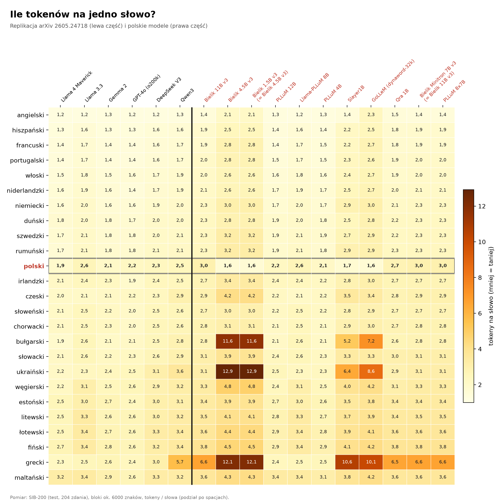
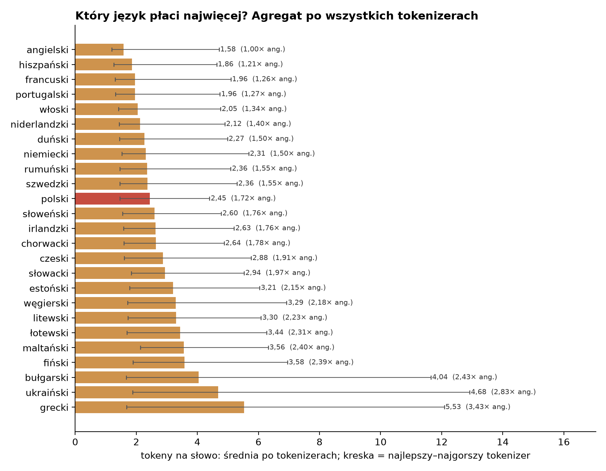
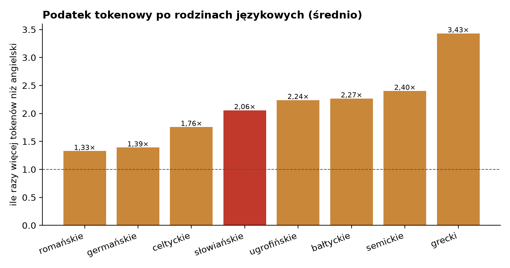
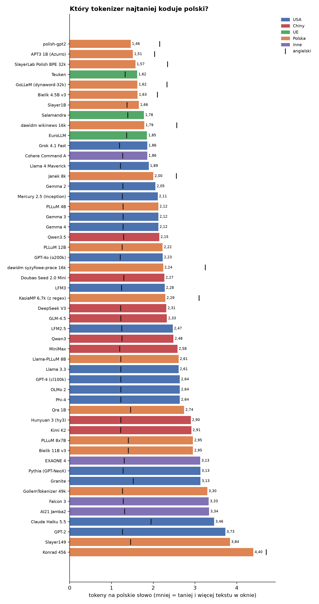
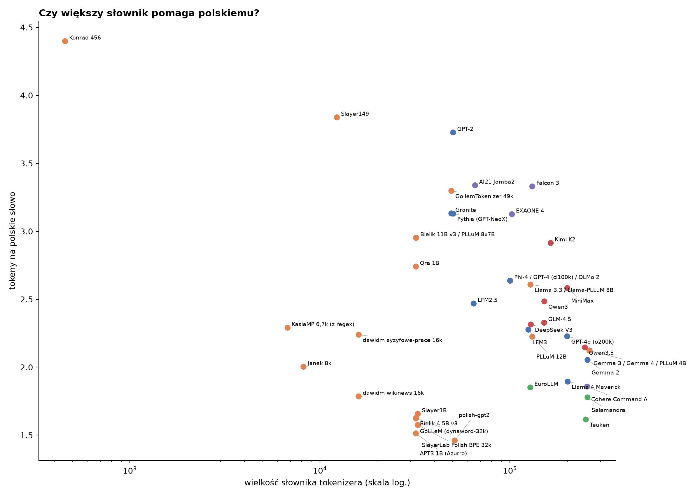
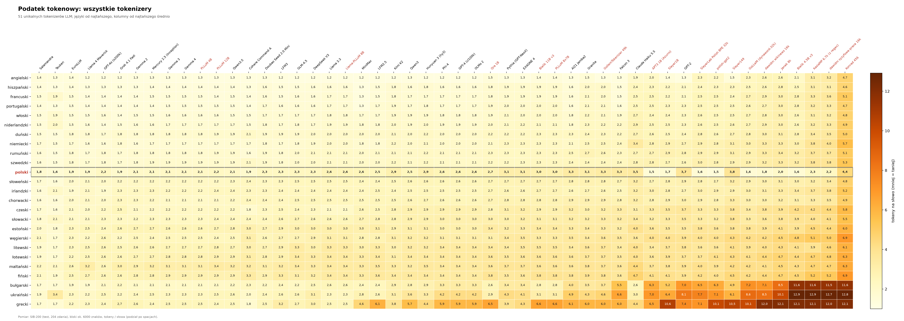
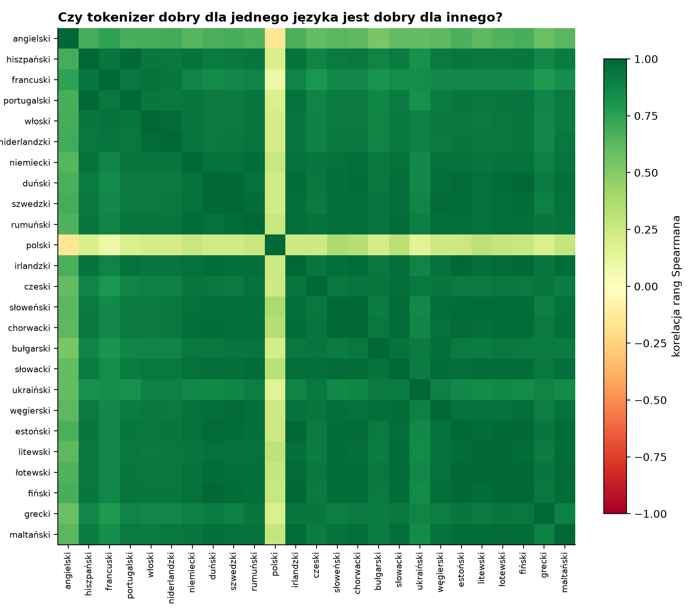
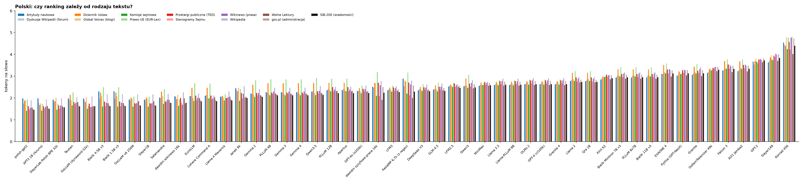
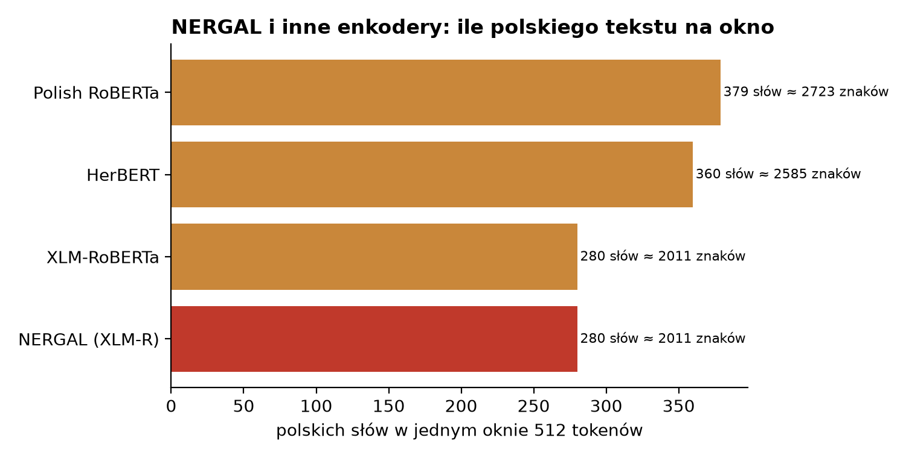

# Podatek tokenowy: ile tokenów na jedno słowo w 25 językach

Replikacja wykresu z pracy [arXiv 2605.24718](https://arxiv.org/abs/2605.24718) („The Tokenizer Tax Across 25 European
Languages”) dla polskich modeli (PLLuM, Bielik, Slayer1B i inne) i rozszerzenie z analizą w agregacie: języki, rodziny językowe,
grupy tokenizerów. Zmierzono 69 modeli (63 lokalnie, 6 przez API); po
odrzuceniu powtórzeń tego samego tokenizera zostaje **51 unikalnych tokenizerów LLM**. Do tego
4 tokenizery enkoderów (NERGAL i porównanie).

Autor: ArtSmol. Data: 2026-11-01. Dane: [Hugging Face](https://huggingface.co/datasets/adegier/tokenizer-fertility-pl). Kod: [GitHub](https://github.com/adgr3/tokenizer-tax-pl).

## Najważniejsze wnioski

- **Polski** kosztuje średnio **2,45 tokenu na słowo**, czyli **1,72×** tyle co angielski (miejsce 11 z 25 języków). Rozrzut między tokenizerami jest duży: od 1,46 (polish-gpt2) do 4,40 (Konrad 456).
- Najtaniej wychodzą: angielski (1,58), hiszpański (1,86), francuski (1,96). Najdrożej: bułgarski (4,04), ukraiński (4,68), grecki (5,53).
- Po rodzinach językowych (ile razy drożej niż angielski): romańskie 1,33×, germańskie 1,39×, celtyckie 1,76×, słowiańskie 2,06×, ugrofińskie 2,24×, bałtyckie 2,27×, semickie 2,40×, grecki 3,43×.
- Najlepsze tokenizery dla polskiego: polish-gpt2 (1,46), APT3 1B (Azurro) (1,51), SlayerLab Polish BPE 32k (1,57); najsłabsze: GPT-2 (3,73), Slayer149 (3,84), Konrad 456 (4,40).
- Tokenizery polskich modeli: średnio 2,36 tok./słowo po polsku; pozostałe: 2,50.
- Wielkość słownika a polski: korelacja rang Spearmana -0,18 (dla angielskiego -0,66). Wartość ujemna = większy słownik, mniej tokenów.
- Ranking tokenizerów jest między językami stabilny: średnia korelacja rang 0,85. Polskiemu najbliżej rankingiem do: słoweński, najdalej: angielski.
- Polski na różnych rodzajach tekstu: zgodność rankingu z SIB-200 (Spearman): Artykuły naukowe 0,96, Dyskusje Wikipedii (forum) 0,99, Dziennik Ustaw 0,96, Global Voices (blogi) 0,97, Komisje sejmowe 0,99, Prawo UE (EUR-Lex) 0,89, Przetargi publiczne (TED) 0,99, Stenogramy Sejmu 0,99, Wikinews (prasa) 0,99, Wikipedia 0,99, Wolne Lektury 0,98, gov.pl (administracja) 1,00.
- Modele przez API z tokenizerem identycznym jak lokalny: GPT-4.1 nano (kontrola) = GPT-4o (o200k).

### Co z tego wynika

*To wnioski autora na podstawie liczb z raportu, nie osobny pomiar.*

Polski tekst kosztuje średnio 1,72× tyle tokenów co angielski (2,45 wobec 1,58 tokenu na słowo). To więcej niż w językach
romańskich i germańskich, ale mniej niż w bałtyckich, ugrofińskich czy w greckim. Przy wyborze modelu do polskich
zastosowań bardziej liczy się to, na czym tokenizer był uczony, niż wielkość słownika: najoszczędniejsze są tokenizery
uczone na polskim (polish-gpt2 1,46, APT3 1,51, Bielik 4.5B v3 1,63, Slayer1B 1,66) przy słowniku ok. 32–50 tys.,
a wielkość słownika słabo wiąże się z wynikiem dla polskiego (korelacja −0,18 wobec −0,66 dla angielskiego). Nie każdy
„polski” model ma jednak polski tokenizer: Bielik 11B v3 i PLLuM 8x7B (2,95), Llama-PLLuM 8B (2,61) i PLLuM 12B (2,22)
dziedziczą tokenizer modelu bazowego. Tokenizery uczone tylko na polskim wygrywają po polsku, ale wyraźnie przegrywają
w innych językach, dlatego ranking dla polskiego najsłabiej zgadza się z rankingami pozostałych języków (to samo podbija
średnie innych języków w agregacie). Dla kosztu API: w tej próbie Grok 4.1 Fast koduje polski najoszczędniej (1,86),
a Claude Haiku 5.5 najdrożej (3,46), czyli ten sam polski tekst to u Claude'a prawie dwa razy więcej tokenów; po
uwzględnieniu ceny najtańszy na 1000 polskich słów jest Doubao Seed 2.0 Mini (0,000068 USD).

### Modele przez API, których nie zmierzono

- Gemini Pro (AIHubMix): „model cannot be served” — innego Gemini z ceną wejścia ≤ 0,20 USD/1 mln tokenów nie ma.
- ERNIE X1 Turbo (brak dostępu, HTTP 401) i ERNIE 4.5 Turbo (model offline) — rodzina ERNIE bez wyniku.
- Jev (model decyzyjny): HTTP 404 przez `chat/completions` — zgodnie z regułą pominięty.
- Darmowe modele AIHubMix (Cohere North Mini, Kimi K3, dots.3, Flint, Xing 4.0): wyczerpany dzienny limit darmowych
  zapytań (North: 92 ze 126 zapytań); skrypt dokończy je kolejnego dnia.
- OpenRouter: Inkling (Thinking Machines) dostępny tylko w aplikacjach agentowych (HTTP 403); darmowe modele kontrolne
  (Gemma 4, LFM2.5) chwilowo przeciążone u dostawców (HTTP 429) — do ponowienia kolejnego dnia.
- Amazon Nova: brak w katalogu AIHubMix.



## Metoda

- Tekst: [SIB-200](https://huggingface.co/datasets/Davlan/sib200), split testowy, 204 te same zdania w 25 językach
  (24 języki UE i ukraiński — zestaw z pracy). Zdania sklejone w bloki po ok. 6000 znaków.
- Miara: **tokeny na słowo**, słowo = ciąg znaków rozdzielony spacjami; wynik = średnia po blokach (jak w pracy).
  Tokeny liczone bez znaczników specjalnych (BOS/EOS).
- Tokenizery otwarte: liczone lokalnie (pobrany tylko tokenizer, bez wag modelu). Przez API: AIHubMix — modele z ceną wejścia ≤ 0,20 USD/1 mln tokenów, 5 bloki na język (błąd próbkowania ≤ 0,03); OpenRouter — tylko darmowe modele spoza AIHubMix, 1 blok na język (błąd średnio 0,042, maks. 0,303). Wydano 0,2919 USD.
- Jeden tokenizer = jedna kolumna w agregatach. Modele dzielące tokenizer (identyczne wyniki na tekstach kontrolnych)
  są aliasami; polskie modele z polecenia zostają w tabeli replikacji z dopiskiem „= …”.
- Kalibracja: Na 150 parach (tokenizer × język) średnia różnica wobec danych autora pracy to **0,014** tokenu na słowo, maksymalna 0,068 → kalibracja zaliczona.

## Replikacja: tokenizery z pracy i polskie modele

| język | Llama 4 Maverick | Llama 3.3 | Gemma 2 | GPT-4o (o200k) | DeepSeek V3 | Qwen3 | Bielik 11B v3 | Bielik 4.5B v3 | Bielik 1.5B v3 | PLLuM 12B | Llama-PLLuM 8B | PLLuM 4B | Slayer1B | GoLLeM (dynaword-32k) | Qra 1B | Bielik Minitron 7B v3 | PLLuM 8x7B |
|---|---|---|---|---|---|---|---|---|---|---|---|---|---|---|---|---|---|
| angielski | 1,2 | 1,2 | 1,3 | 1,2 | 1,2 | 1,3 | 1,4 | 2,1 | 2,1 | 1,3 | 1,2 | 1,3 | 1,4 | 2,3 | 1,5 | 1,4 | 1,4 |
| hiszpański | 1,3 | 1,6 | 1,3 | 1,3 | 1,6 | 1,6 | 1,9 | 2,5 | 2,5 | 1,4 | 1,6 | 1,4 | 2,2 | 2,5 | 1,8 | 1,9 | 1,9 |
| francuski | 1,4 | 1,7 | 1,4 | 1,4 | 1,6 | 1,7 | 1,9 | 2,8 | 2,8 | 1,4 | 1,7 | 1,5 | 2,2 | 2,7 | 1,8 | 1,9 | 1,9 |
| portugalski | 1,4 | 1,7 | 1,4 | 1,4 | 1,6 | 1,7 | 2,0 | 2,8 | 2,8 | 1,5 | 1,7 | 1,5 | 2,3 | 2,6 | 1,9 | 2,0 | 2,0 |
| włoski | 1,5 | 1,8 | 1,5 | 1,6 | 1,7 | 1,9 | 2,0 | 2,6 | 2,6 | 1,6 | 1,8 | 1,6 | 2,4 | 2,7 | 1,9 | 2,0 | 2,0 |
| niderlandzki | 1,6 | 1,9 | 1,6 | 1,4 | 1,7 | 1,9 | 2,1 | 2,6 | 2,6 | 1,7 | 1,9 | 1,7 | 2,5 | 2,7 | 2,0 | 2,1 | 2,1 |
| niemiecki | 1,6 | 2,0 | 1,6 | 1,6 | 1,9 | 2,0 | 2,3 | 3,0 | 3,0 | 1,7 | 2,0 | 1,7 | 2,9 | 3,0 | 2,1 | 2,3 | 2,3 |
| duński | 1,8 | 2,0 | 1,8 | 1,7 | 2,0 | 2,0 | 2,3 | 2,8 | 2,8 | 1,9 | 2,0 | 1,8 | 2,5 | 2,8 | 2,2 | 2,3 | 2,3 |
| szwedzki | 1,7 | 2,1 | 1,8 | 1,8 | 2,0 | 2,1 | 2,3 | 3,2 | 3,2 | 1,9 | 2,1 | 1,9 | 2,7 | 2,9 | 2,2 | 2,3 | 2,3 |
| rumuński | 1,7 | 2,1 | 1,8 | 1,8 | 2,1 | 2,1 | 2,3 | 3,2 | 3,2 | 1,9 | 2,1 | 1,8 | 2,9 | 2,9 | 2,3 | 2,3 | 2,3 |
| **polski** | 1,9 | 2,6 | 2,1 | 2,2 | 2,3 | 2,5 | 3,0 | 1,6 | 1,6 | 2,2 | 2,6 | 2,1 | 1,7 | 1,6 | 2,7 | 3,0 | 3,0 |
| irlandzki | 2,1 | 2,4 | 2,3 | 1,9 | 2,4 | 2,5 | 2,7 | 3,4 | 3,4 | 2,4 | 2,4 | 2,2 | 2,8 | 3,0 | 2,7 | 2,7 | 2,7 |
| czeski | 2,0 | 2,1 | 2,1 | 2,2 | 2,3 | 2,9 | 2,9 | 4,2 | 4,2 | 2,2 | 2,1 | 2,2 | 3,5 | 3,4 | 2,8 | 2,9 | 2,9 |
| słoweński | 2,1 | 2,5 | 2,2 | 2,0 | 2,5 | 2,6 | 2,7 | 3,0 | 3,0 | 2,2 | 2,5 | 2,2 | 2,8 | 2,9 | 2,7 | 2,7 | 2,7 |
| chorwacki | 2,1 | 2,5 | 2,3 | 2,0 | 2,5 | 2,6 | 2,8 | 3,1 | 3,1 | 2,1 | 2,5 | 2,1 | 2,9 | 3,0 | 2,7 | 2,8 | 2,8 |
| bułgarski | 1,9 | 2,6 | 2,1 | 2,1 | 2,5 | 2,8 | 2,8 | 11,6 | 11,6 | 2,1 | 2,6 | 2,1 | 5,2 | 7,2 | 2,6 | 2,8 | 2,8 |
| słowacki | 2,1 | 2,6 | 2,2 | 2,3 | 2,6 | 2,9 | 3,1 | 3,9 | 3,9 | 2,4 | 2,6 | 2,3 | 3,3 | 3,3 | 3,0 | 3,1 | 3,1 |
| ukraiński | 2,2 | 2,3 | 2,4 | 2,5 | 3,1 | 3,6 | 3,1 | 12,9 | 12,9 | 2,5 | 2,3 | 2,3 | 6,4 | 8,6 | 2,9 | 3,1 | 3,1 |
| węgierski | 2,2 | 3,1 | 2,5 | 2,6 | 2,9 | 3,2 | 3,3 | 4,8 | 4,8 | 2,4 | 3,1 | 2,5 | 4,0 | 4,2 | 3,1 | 3,3 | 3,3 |
| estoński | 2,5 | 3,0 | 2,7 | 2,4 | 3,0 | 3,1 | 3,4 | 3,9 | 3,9 | 2,7 | 3,0 | 2,6 | 3,5 | 3,8 | 3,4 | 3,4 | 3,4 |
| litewski | 2,5 | 3,3 | 2,6 | 2,6 | 3,0 | 3,2 | 3,5 | 4,1 | 4,1 | 2,8 | 3,3 | 2,7 | 3,7 | 3,9 | 3,4 | 3,5 | 3,5 |
| łotewski | 2,5 | 3,4 | 2,7 | 2,6 | 3,3 | 3,4 | 3,6 | 4,4 | 4,4 | 2,9 | 3,4 | 2,8 | 3,9 | 4,1 | 3,6 | 3,6 | 3,6 |
| fiński | 2,7 | 3,4 | 2,8 | 2,6 | 3,2 | 3,4 | 3,8 | 4,5 | 4,5 | 2,9 | 3,4 | 2,9 | 4,1 | 4,2 | 3,8 | 3,8 | 3,8 |
| grecki | 2,3 | 2,5 | 2,6 | 2,4 | 3,0 | 5,7 | 6,6 | 12,1 | 12,1 | 2,4 | 2,5 | 2,5 | 10,6 | 10,1 | 6,5 | 6,6 | 6,6 |
| maltański | 3,2 | 3,4 | 2,9 | 2,6 | 3,3 | 3,2 | 3,6 | 4,3 | 4,3 | 3,4 | 3,4 | 3,1 | 3,8 | 4,2 | 3,6 | 3,6 | 3,6 |

## Agregat po językach



| język | rodzina | średnio | mediana | min | najlepszy tokenizer | maks. | najgorszy | × ang. |
|---|---|---|---|---|---|---|---|---|
| angielski | germańskie | 1,58 | 1,28 | 1,19 | Grok 4.1 Fast | 4,71 | Konrad 456 | 1,00 |
| hiszpański | romańskie | 1,86 | 1,61 | 1,26 | MiniMax | 4,63 | Konrad 456 | 1,21 |
| francuski | romańskie | 1,96 | 1,66 | 1,31 | MiniMax | 5,10 | Konrad 456 | 1,26 |
| portugalski | romańskie | 1,96 | 1,70 | 1,32 | MiniMax | 4,74 | Konrad 456 | 1,27 |
| włoski | romańskie | 2,05 | 1,85 | 1,42 | Grok 4.1 Fast | 4,76 | Konrad 456 | 1,34 |
| niderlandzki | germańskie | 2,12 | 1,90 | 1,44 | GPT-4o (o200k) | 4,90 | Konrad 456 | 1,40 |
| duński | germańskie | 2,27 | 2,09 | 1,45 | Teuken | 4,99 | Konrad 456 | 1,50 |
| niemiecki | germańskie | 2,31 | 2,01 | 1,53 | Teuken | 5,68 | Konrad 456 | 1,50 |
| rumuński | romańskie | 2,36 | 2,14 | 1,46 | Teuken | 5,09 | Konrad 456 | 1,55 |
| szwedzki | germańskie | 2,36 | 2,15 | 1,47 | Teuken | 5,30 | Konrad 456 | 1,55 |
| polski | słowiańskie | 2,45 | 2,29 | 1,46 | polish-gpt2 | 4,40 | Konrad 456 | 1,72 |
| słoweński | słowiańskie | 2,60 | 2,55 | 1,55 | Teuken | 4,78 | Konrad 456 | 1,76 |
| irlandzki | celtyckie | 2,63 | 2,46 | 1,58 | Salamandra | 5,20 | Konrad 456 | 1,76 |
| chorwacki | słowiańskie | 2,64 | 2,57 | 1,59 | Salamandra | 4,88 | Konrad 456 | 1,78 |
| czeski | słowiańskie | 2,88 | 2,93 | 1,60 | Teuken | 5,76 | Konrad 456 | 1,91 |
| słowacki | słowiańskie | 2,94 | 2,96 | 1,84 | Salamandra | 5,53 | Konrad 456 | 1,97 |
| estoński | ugrofińskie | 3,21 | 3,07 | 1,78 | Teuken | 6,04 | Konrad 456 | 2,15 |
| węgierski | ugrofińskie | 3,29 | 3,14 | 1,72 | Teuken | 6,92 | Konrad 456 | 2,18 |
| litewski | bałtyckie | 3,30 | 3,38 | 1,73 | Teuken | 6,09 | Konrad 456 | 2,23 |
| łotewski | bałtyckie | 3,44 | 3,44 | 1,69 | Teuken | 6,27 | Konrad 456 | 2,31 |
| maltański | semickie | 3,56 | 3,43 | 2,14 | Teuken | 6,32 | Konrad 456 | 2,40 |
| fiński | ugrofińskie | 3,58 | 3,43 | 1,89 | Teuken | 6,95 | Konrad 456 | 2,39 |
| bułgarski | słowiańskie | 4,04 | 2,76 | 1,67 | Teuken | 11,65 | Bielik 4.5B v3 | 2,43 |
| ukraiński | słowiańskie | 4,68 | 3,12 | 1,88 | Salamandra | 12,92 | Bielik 4.5B v3 | 2,83 |
| grecki | grecki | 5,53 | 4,56 | 1,68 | Teuken | 12,08 | Bielik 4.5B v3 | 3,43 |



| rodzina | średnio tok./słowo | × ang. | języków |
|---|---|---|---|
| romańskie | 2,04 | 1,33 | 5 |
| germańskie | 2,13 | 1,39 | 5 |
| celtyckie | 2,63 | 1,76 | 1 |
| słowiańskie | 3,17 | 2,06 | 7 |
| ugrofińskie | 3,36 | 2,24 | 3 |
| bałtyckie | 3,37 | 2,27 | 2 |
| semickie | 3,56 | 2,40 | 1 |
| grecki | 5,53 | 3,43 | 1 |

## Agregat po tokenizerach



| tokenizer | pochodzenie | słownik | PL | EN | PL/EN | średnio 25 jęz. | najgorszy język | × ang. | PL słów w 4096 tok. |
|---|---|---|---|---|---|---|---|---|---|
| polish-gpt2 | Polska | 51200 | 1,46 | 2,15 | 0,68 | 3,55 | grecki | 4,69 | 2804 |
| APT3 1B (Azurro) | Polska | 31980 | 1,51 | 2,03 | 0,74 | 3,36 | ukraiński | 3,43 | 2707 |
| SlayerLab Polish BPE 32k | Polska | 32768 | 1,57 | 2,34 | 0,67 | 3,52 | ukraiński | 3,30 | 2602 |
| Teuken | UE | 250680 | 1,62 | 1,33 | 1,22 | 1,76 | ukraiński | 2,56 | 2536 |
| GoLLeM (dynaword-32k) | Polska | 32000 | 1,62 | 2,33 | 0,70 | 3,79 | grecki | 4,31 | 2525 |
| Bielik 4.5B v3 | Polska | 32000 | 1,63 | 2,10 | 0,77 | 4,38 | ukraiński | 6,15 | 2519 |
| Slayer1B | Polska | 32768 | 1,66 | 1,38 | 1,20 | 3,44 | grecki | 7,72 | 2472 |
| Salamandra | UE | 256000 | 1,78 | 1,39 | 1,28 | 1,71 | maltański | 1,57 | 2304 |
| dawidm wikinews 16k | Polska | 16000 | 1,79 | 2,56 | 0,70 | 4,00 | grecki | 4,67 | 2294 |
| EuroLLM | UE | 128000 | 1,85 | 1,36 | 1,36 | 1,93 | maltański | 1,89 | 2213 |
| Grok 4.1 Fast | USA | — | 1,86 | 1,19 | 1,56 | 2,06 | maltański | 2,53 | 2206 |
| Cohere Command A | inne | 255033 | 1,86 | 1,27 | 1,46 | 2,16 | fiński | 2,63 | 2205 |
| Llama 4 Maverick | USA | 201135 | 1,89 | 1,22 | 1,56 | 1,99 | maltański | 2,65 | 2163 |
| Janek 8k | Polska | 8192 | 2,00 | 2,56 | 0,78 | 4,28 | grecki | 4,72 | 2045 |
| Gemma 2 | USA | 256000 | 2,05 | 1,27 | 1,61 | 2,08 | maltański | 2,31 | 1995 |
| Mercury 2.5 (Inception) | USA | — | 2,11 | 1,26 | 1,68 | 2,10 | maltański | 2,52 | 1941 |
| PLLuM 4B | Polska | 262147 | 2,12 | 1,28 | 1,66 | 2,11 | maltański | 2,43 | 1930 |
| Gemma 3 | USA | 262145 | 2,12 | 1,28 | 1,66 | 2,11 | maltański | 2,43 | 1930 |
| Gemma 4 | USA | 262144 | 2,12 | 1,28 | 1,66 | 2,11 | maltański | 2,43 | 1930 |
| Qwen3.5 | Chiny | 248077 | 2,15 | 1,29 | 1,66 | 2,16 | maltański | 2,51 | 1909 |
| PLLuM 12B | Polska | 131072 | 2,22 | 1,25 | 1,77 | 2,15 | maltański | 2,68 | 1841 |
| GPT-4o (o200k) | USA | 200019 | 2,23 | 1,21 | 1,84 | 2,02 | łotewski | 2,16 | 1839 |
| dawidm syzyfowe-prace 16k | Polska | 16000 | 2,24 | 3,25 | 0,69 | 4,84 | ukraiński | 3,93 | 1830 |
| Doubao Seed 2.0 Mini | Chiny | — | 2,27 | 1,30 | 1,75 | 2,20 | maltański | 2,38 | 1807 |
| LFM3 | USA | 125033 | 2,28 | 1,24 | 1,83 | 2,28 | fiński | 2,64 | 1800 |
| KasiaMP 6,7k (z regex) | Polska | 6756 | 2,29 | 3,10 | 0,74 | 4,76 | ukraiński | 4,16 | 1788 |
| DeepSeek V3 | Chiny | 128815 | 2,31 | 1,22 | 1,90 | 2,37 | maltański | 2,68 | 1770 |
| GLM-4.5 | Chiny | 151365 | 2,33 | 1,23 | 1,90 | 2,34 | łotewski | 2,75 | 1760 |
| LFM2.5 | USA | 64400 | 2,47 | 1,25 | 1,98 | 2,54 | grecki | 4,91 | 1660 |
| Qwen3 | Chiny | 151669 | 2,48 | 1,25 | 1,99 | 2,64 | grecki | 4,55 | 1649 |
| MiniMax | Chiny | 200054 | 2,58 | 1,20 | 2,16 | 2,41 | grecki | 3,81 | 1586 |
| Llama 3.3 | USA | 128256 | 2,61 | 1,22 | 2,13 | 2,39 | maltański | 2,77 | 1571 |
| Llama-PLLuM 8B | Polska | 128259 | 2,61 | 1,22 | 2,13 | 2,39 | maltański | 2,77 | 1571 |
| Phi-4 | USA | 100352 | 2,64 | 1,22 | 2,15 | 2,70 | grecki | 4,78 | 1554 |
| GPT-4 (cl100k) | USA | 100277 | 2,64 | 1,22 | 2,15 | 2,70 | grecki | 4,78 | 1554 |
| OLMo 2 | USA | 100278 | 2,64 | 1,22 | 2,15 | 2,70 | grecki | 4,78 | 1554 |
| Qra 1B | Polska | 32000 | 2,74 | 1,46 | 1,88 | 2,77 | grecki | 4,48 | 1495 |
| Hunyuan 3 (hy3) | Chiny | — | 2,90 | 1,23 | 2,37 | 2,64 | grecki | 3,56 | 1413 |
| Kimi K2 | Chiny | 163840 | 2,91 | 1,22 | 2,38 | 2,55 | grecki | 3,13 | 1406 |
| Bielik 11B v3 | Polska | 32128 | 2,95 | 1,40 | 2,10 | 2,86 | grecki | 4,72 | 1388 |
| PLLuM 8x7B | Polska | 32003 | 2,95 | 1,40 | 2,10 | 2,86 | grecki | 4,72 | 1388 |
| EXAONE 4 | inne | 102400 | 3,13 | 1,31 | 2,39 | 2,84 | grecki | 3,33 | 1310 |
| Pythia (GPT-NeoX) | USA | 50277 | 3,13 | 1,28 | 2,44 | 2,79 | ukraiński | 3,34 | 1309 |
| Granite | USA | 49152 | 3,13 | 1,52 | 2,06 | 3,02 | grecki | 3,91 | 1308 |
| GollemTokenizer 49k | Polska | 49152 | 3,30 | 1,27 | 2,60 | 3,03 | grecki | 4,75 | 1242 |
| Falcon 3 | inne | 131072 | 3,33 | 1,28 | 2,60 | 3,04 | ukraiński | 5,12 | 1230 |
| AI21 Jamba2 | inne | 65536 | 3,34 | 1,31 | 2,54 | 2,93 | grecki | 4,65 | 1227 |
| Claude Haiku 5.5 | USA | — | 3,46 | 1,95 | 1,77 | 3,23 | fiński | 2,41 | 1184 |
| GPT-2 | USA | 50257 | 3,73 | 1,26 | 2,95 | 3,51 | ukraiński | 6,43 | 1099 |
| Slayer149 | Polska | 12288 | 3,84 | 1,46 | 2,63 | 3,72 | grecki | 7,17 | 1067 |
| Konrad 456 | Polska | 456 | 4,40 | 4,71 | 0,93 | 6,22 | ukraiński | 2,72 | 931 |

### Grupy tokenizerów

Według pochodzenia:

| pochodzenie | tokenizerów | PL | średnio 25 | PL/EN |
|---|---|---|---|---|
| UE | 3 | 1,75 | 1,80 | 1,29 |
| Polska | 19 | 2,36 | 3,58 | 1,34 |
| Chiny | 8 | 2,49 | 2,41 | 2,01 |
| USA | 17 | 2,53 | 2,49 | 1,95 |
| inne | 4 | 2,91 | 2,74 | 2,25 |

Według wielkości słownika:

| słownik | tokenizerów | PL | średnio 25 | PL/EN |
|---|---|---|---|---|
| > 210 tys. | 8 | 1,98 | 2,02 | 1,53 |
| 160–210 tys. | 4 | 2,40 | 2,24 | 1,98 |
| nieznany (API) | 5 | 2,52 | 2,45 | 1,82 |
| ≤ 64 tys. | 19 | 2,52 | 3,72 | 1,44 |
| 64–160 tys. | 15 | 2,59 | 2,53 | 2,07 |





## Czy ranking zależy od języka?



Średnia korelacja rang Spearmana między językami: 0,85.

## Polski na różnych rodzajach tekstu



Próbki z [SlayerLab/polish-dynaword](https://huggingface.co/datasets/SlayerLab/polish-dynaword); tekstów nie publikujemy.
Zgodność rankingu z SIB-200 (Spearman): Artykuły naukowe 0,96, Dyskusje Wikipedii (forum) 0,99, Dziennik Ustaw 0,96, Global Voices (blogi) 0,97, Komisje sejmowe 0,99, Prawo UE (EUR-Lex) 0,89, Przetargi publiczne (TED) 0,99, Stenogramy Sejmu 0,99, Wikinews (prasa) 0,99, Wikipedia 0,99, Wolne Lektury 0,98, gov.pl (administracja) 1,00.

## Modele przez API: koszt polskiego tekstu

| model | PL | EN | USD / 1 mln tok. | USD / 1000 PL słów |
|---|---|---|---|---|
| Grok 4.1 Fast | 1,86 | 1,19 | 0,200 | 0,000371 |
| Mercury 2.5 (Inception) | 2,11 | 1,26 | 0,200 | 0,000422 |
| Doubao Seed 2.0 Mini | 2,27 | 1,30 | 0,030 | 0,000068 |
| Hunyuan 3 (hy3) | 2,90 | 1,23 | 0,156 | 0,000453 |
| Claude Haiku 5.5 | 3,46 | 1,95 | 0,100 | 0,000346 |

## Dla Bench Team (Slayer 1B, modele odniesienia, Pythia)

Ile tokenów na polskie i angielskie słowo oraz ile bajtów UTF-8 przypada na token. Przydaje się przy porównywaniu
wyników liczonych na token (np. BLiMP na token), przy przeliczaniu udziału angielskiego w danych między tokenizerami
i przy decyzji o tokenizerze kolejnej wersji Slayera.

| model | PL tok./słowo | EN tok./słowo | PL bajtów/token | EN bajtów/token | PL tokenów vs Slayer |
|---|---|---|---|---|---|
| Bielik 1.5B v3 | 1,63 | 2,10 | 4,68 | 2,90 | 0,98 |
| Slayer1B | 1,66 | 1,38 | 4,59 | 4,43 | 1,00 |
| EuroLLM | 1,85 | 1,36 | 4,11 | 4,47 | 1,12 |
| Qwen3.5 | 2,15 | 1,29 | 3,55 | 4,71 | 1,29 |
| LFM3 | 2,28 | 1,24 | 3,34 | 4,91 | 1,37 |
| LFM2.5 | 2,47 | 1,25 | 3,08 | 4,89 | 1,49 |
| Pythia (GPT-NeoX) | 3,13 | 1,28 | 2,43 | 4,76 | 1,89 |

## Dla NERGAL-a (enkodery)

NERGAL to XLM-RoBERTa-large z dwoma znacznikami; tnie tekst na okna do 512 tokenów. Tabela pokazuje, ile polskiego tekstu
mieści jedno okno w porównaniu z polskimi enkoderami. To przybliżenie (bez znaczników specjalnych i bez nakładania okien).



| enkoder | słownik | PL tok./słowo | PL słów / okno 512 | PL znaków / okno 512 | tokenów vs NERGAL |
|---|---|---|---|---|---|
| Polish RoBERTa | 128001 | 1,35 | 379 | 2723 | 0,74 |
| HerBERT | 50000 | 1,42 | 360 | 2585 | 0,78 |
| XLM-RoBERTa | 250002 | 1,82 | 280 | 2011 | 1,00 |
| NERGAL (XLM-R) | 250004 | 1,82 | 280 | 2011 | 1,00 |

## Ograniczenia

- Jeden rodzaj tekstu w porównaniu 25 języków (wiadomości, SIB-200/FLORES); inne rodzaje tylko dla polskiego.
- „Słowo” liczone po spacjach — języki z długimi złożeniami (fiński, węgierski, niemiecki) mają mniej, dłuższych słów.
- Przez API liczba tokenów pochodzi od dostawcy; narzut szablonu czatu odjęty na podstawie zapytania „x”.
  Modele OpenRouter liczone na 1 bloku na język (mniejsza dokładność).
- Tokeny na słowo to koszt i pojemność kontekstu, a nie jakość modelu.

## Aliasy i pominięte tokenizery

Aliasy (ten sam tokenizer):
- Bielik 1.5B v3 → ten sam tokenizer co Bielik 4.5B v3
- Bielik Minitron 7B v3 → ten sam tokenizer co Bielik 11B v3
- GoLLeM v6 250M → ten sam tokenizer co Slayer1B
- Apertus → ten sam tokenizer co PLLuM 12B
- Mistral Nemo (Tekken) → ten sam tokenizer co PLLuM 12B
- Llama 2 → ten sam tokenizer co Qra 1B
- SmolLM3 → ten sam tokenizer co Llama 3.3
- Nemotron → ten sam tokenizer co PLLuM 12B
- Mistral Large 3 (z pracy) → ten sam tokenizer co PLLuM 12B
- Nemotron Super 3 (z pracy) → ten sam tokenizer co PLLuM 12B
- gpt-oss (o200k harmony) → ten sam tokenizer co GPT-4o (o200k)
- Granite 4 → ten sam tokenizer co Phi-4
- OLMo 3 → ten sam tokenizer co OLMo 2
- GPT-4.1 nano (kontrola) → ten sam tokenizer co GPT-4o (o200k)

Pominięte (z powodem):
- bielik_pl_11b_v3: speakleash/Bielik-PL-11B-v3.0-Instruct: GatedRepoError: 401 Client Error. (Request ID: Root=1-6ae77794-02fa2b094e78f96b41629006;159ca591-622f-4502-9b4c-faba063f

## Źródła i podziękowania

- Praca i dane referencyjne: V. Ovcharov, [arXiv 2605.24718](https://arxiv.org/abs/2605.24718),
  [overthelex/tokenizer-fertility-map](https://huggingface.co/datasets/overthelex/tokenizer-fertility-map).
- Pierwsza polska wersja wykresu i metoda bloków: Dariusz Ciba.
- Tekst: [SIB-200](https://huggingface.co/datasets/Davlan/sib200) (CC BY-SA 4.0), [polish-dynaword](https://huggingface.co/datasets/SlayerLab/polish-dynaword).

## Jak odtworzyć

```bash
python -m venv .venv && .venv/bin/pip install -r requirements.txt   # Windows: .venv\Scripts\pip
python -m tt.data            # SIB-200
python -m tt.measure_local   # tokenizery lokalne
python -m tt.calibrate       # zgodność z danymi z pracy
python -m tt.subsample       # ile bloków wystarczy przez API
python -m tt.api_models && python -m tt.measure_api   # API (klucze w .env)
python -m tt.polish --sample && python -m tt.polish   # polski: rodzaje tekstu (opcjonalnie)
python -m tt.analyze && python -m tt.charts && python -m tt.report
```

Wyniki surowe: `results/local/`, `results/apisum/`, tabele: `results/tables/`, liczby raportu: `results/summary.json`.
