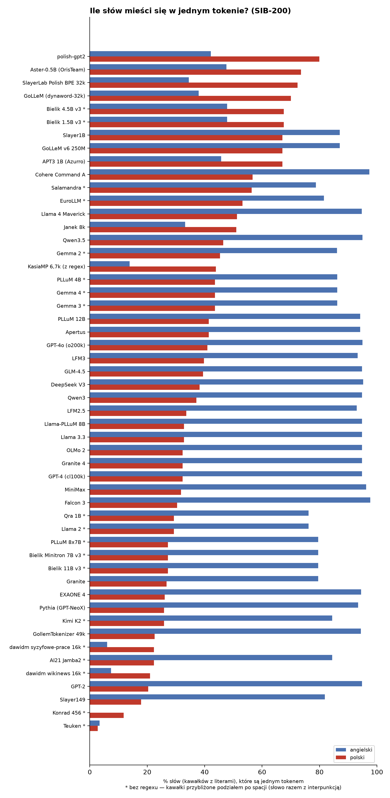
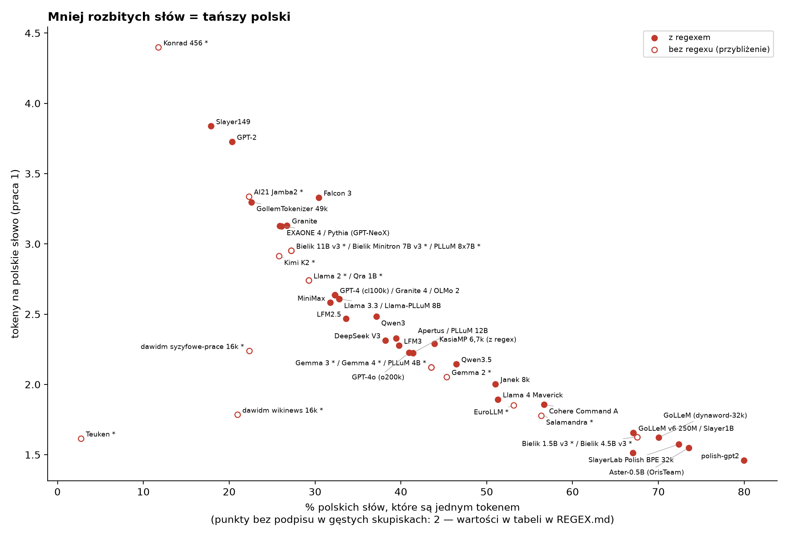

# Regexy tokenizerów: co robią i po co

Praca domowa 2 (fabryka.ai). Regex z grafiki to pre-tokenizer **GPT-4o (o200k_base)**; obok GPT-2, GPT-4 (cl100k)
i DeepSeek V3. Analiza na tych samych tokenizerach co [praca 1 (tokeny na słowo)](README.md). Data: 2026-11-02.

## Po co tokenizerowi regex

Tokenizer BPE nie skleja tokenów na całym tekście naraz. Najpierw **regex tnie tekst na kawałki** (pre-tokeny), a
dopiero potem BPE skleja bajty **wewnątrz każdego kawałka**. Token nigdy nie przekracza granicy kawałka. Regex decyduje
więc z góry, co w ogóle *może* stać się jednym tokenem: czy spacja przyklei się do słowa, czy liczba zostanie pocięta,
czy kropka połączy się z następnym słowem.

Albert Gu (współautor Mamby i H-Net) zwrócił uwagę, że takie ręcznie pisane regexy siedzą w każdym czołowym LLM i
„wykonują sporo ciężkiej pracy”, a mało kto o nich wie. Praca *Boundless BPE* (arXiv 2504.00178) pokazuje drugą stronę:
regex sprawia, że 90–95% kawałków to po prostu jeden token (całe słowo), więc częste zwroty z kilku słów nigdy nie
staną się jednym tokenem.

Notacja klas znaków (Unicode): `\p{L}` litera dowolnego alfabetu (`Lu` wielka, `Ll` mała, `Lt` tytułowa, `Lm`
modyfikująca, `Lo` litera bez wielkości — np. chińska, arabska), `\p{M}` znak łączący (akcent doklejany do litery),
`\p{N}` cyfra/liczba, `\p{P}` interpunkcja, `\p{S}` symbol, `\s` biały znak, `(?!\S)` „dalej nie ma znaku niebiałego”,
`(?i:…)` bez rozróżniania wielkości liter. W przykładach `␣` = spacja, `⏎` = nowa linia, `│` = granica kawałka.

---

## GPT-2 (2019; używany w wielu modelach do ok. 2022)

```
's|'t|'re|'ve|'m|'ll|'d| ?\p{L}+| ?\p{N}+| ?[^\s\p{L}\p{N}]+|\s+(?!\S)|\s+
```

| # | Fragment | Co robi | Po co |
|---|---|---|---|
| 1 | `'s\|'t\|'re\|'ve\|'m\|'ll\|'d` | odcina angielskie końcówki skrótów jako osobne kawałki | „he's” = „he” + „'s”; ten sam token „'s” w tysiącach słów |
| 2 | ` ?\p{L}+` | ciąg liter z opcjonalną spacją z przodu | słowo razem z poprzedzającą spacją = jeden kawałek („␣Gmina”) |
| 3 | ` ?\p{N}+` | ciąg cyfr dowolnej długości, ze spacją | liczby trzymane razem |
| 4 | ` ?[^\s\p{L}\p{N}]+` | ciąg interpunkcji/symboli, ze spacją | „):”, „␣(” |
| 5 | `\s+(?!\S)` | spacje, ale bez ostatniej przed słowem | ostatnia spacja przykleja się do słowa (reguła 2) |
| 6 | `\s+` | pozostałe spacje | koniec tekstu |

Słabości widoczne na przykładach: skróty tylko małymi literami („They'LL” → `␣They │ ' │ LL`), liczby bez limitu
długości (`␣44051401359` — PESEL to jeden kawałek, więc BPE może zbudować dziwne tokeny z długich ciągów cyfr).

## GPT-4 (cl100k_base, 2023; podobny ma Llama 3)

```
'(?i:[sdmt]|ll|ve|re)|[^\r\n\p{L}\p{N}]?+\p{L}+|\p{N}{1,3}| ?[^\s\p{L}\p{N}]++[\r\n]*|\s*[\r\n]|\s+(?!\S)|\s+
```

Zmiany względem GPT-2:
- skróty bez względu na wielkość liter: `'(?i:…)` („They'LL” → `␣They │ 'LL`);
- **przed słowem może stać jeden dowolny znak, który nie jest literą, cyfrą ani nową linią** — nie tylko spacja:
  `(Łódź`, `.kowalski`, `@gmina`, `-mail` to jeden kawałek;
- **cyfry w grupach po maksymalnie 3**: `\p{N}{1,3}` — „2026” → `202 │ 6`, PESEL → `440 │ 514 │ 013 │ 59`, a spacja
  przed liczbą staje się osobnym kawałkiem (`␣ │ 202 │ 6`). Po co: tokenizer ma najwyżej 1110 tokenów-liczb (0–999),
  więc arytmetyka widzi liczby w regularnych kawałkach;
- interpunkcja może zabrać ze sobą nowe linie (`):⏎`), a nowe linie z wcięciem tworzą osobny kawałek — ważne dla kodu.
- `?+` i `++` to kwantyfikatory zaborcze (bez cofania) — przyspieszają dopasowanie, nie zmieniają wyniku na typowym tekście.

Ten sam regex (bez kwantyfikatorów zaborczych) ma **Llama 3.3** — liczby tnie identycznie: `12345678` → `123 │ 456 │ 78`.
**Qwen3** ma prawie ten sam wzorzec, ale zamiast `\p{N}{1,3}` stoi `\p{N}` — każda cyfra to osobny kawałek
(`2026` → `2 │ 0 │ 2 │ 6`, PESEL = 11 tokenów). Po jednej cyfrze tną też Mistral Nemo i PLLuM 12B (regex „Tekken”,
który — jak GPT-4o — dzieli też na granicy wielkości liter: `XMLHttp │ Request`).

## GPT-4o (o200k_base, 2024) — regex z grafiki

```
[^\r\n\p{L}\p{N}]?[\p{Lu}\p{Lt}\p{Lm}\p{Lo}\p{M}]*[\p{Ll}\p{Lm}\p{Lo}\p{M}]+(?i:'s|'t|'re|'ve|'m|'ll|'d)?
|[^\r\n\p{L}\p{N}]?[\p{Lu}\p{Lt}\p{Lm}\p{Lo}\p{M}]+[\p{Ll}\p{Lm}\p{Lo}\p{M}]*(?i:'s|'t|'re|'ve|'m|'ll|'d)?
|\p{N}{1,3}| ?[^\s\p{L}\p{N}]+[\r\n/]*|\s*[\r\n]+|\s+(?!\S)|\s+
```

| # | Fragment | Co robi | Przykład |
|---|---|---|---|
| 1 | jeden znak-nie-litera? + **wielkie\*** + **małe+** + skrót? | słowo pisane „normalnie” (małe albo Wielka+małe); skrót angielski **doklejony** do słowa | `He's`, `␣Gmina`, `␣Łomianki`, `␣PESELu` |
| 2 | jeden znak-nie-litera? + **wielkie+** + **małe\*** + skrót? | słowo z samych wielkich liter albo zaczynające się ich ciągiem | `␣ZUS`, `PESEL`, `␣They'LL` |
| 3 | `\p{N}{1,3}` | cyfry po maks. 3, jak w GPT-4 | `202 │ 6` |
| 4 | ` ?[^\s\p{L}\p{N}]+[\r\n/]*` | interpunkcja/symbole; może zabrać nowe linie **i ukośniki** | `):⏎`, `␣„`, `://` |
| 5 | `\s*[\r\n]+` | nowe linie (z poprzedzającymi spacjami) | |
| 6 | `\s+(?!\S)` | spacje bez ostatniej przed słowem | wcięcia w kodzie |
| 7 | `\s+` | pozostałe spacje | |

Co nowego (to, czego Albert Gu „nie rozumie”): **granica wielkości liter**. Słowo kończy się tam, gdzie po małych
literach zaczyna się wielka: `XMLHttpRequest` → `␣XMLHttp │ Request`, `McDonald` → `␣Mc │ Donald`. To dzieli
nazwy z kodu (camelCase) i nazwiska na części, które częściej występują osobno. Skróty angielskie są teraz *częścią*
słowa (`He's` jeden kawałek), a klasy `Lm`, `Lo`, `M` są w obu grupach, więc pisma bez wielkich liter (chiński,
arabski) i akcenty łączące działają w obu gałęziach.

Dla polskiego: `PESELu` zostaje jednym kawałkiem (wielkie, potem małe), ale `ZUS-u` → `␣ZUS │ -u`, a `ZP.271.12.2026`
→ `␣ZP │ . │ 271 │ . │ 12 │ . │ 202 │ 6`.

## DeepSeek V3 (2024) — regex z grafiki (trzy kroki po kolei)

```
krok 1: \p{N}{1,3}
krok 2: [一-龥぀-ゟ゠-ヿ]+
krok 3: [!"#$%&'()*+,\-./:;<=>?@\[\\\]^_`{|}~][A-Za-z]+|[^\r\n\p{L}\p{P}\p{S}]?[\p{L}\p{M}]+| ?[\p{P}\p{S}]+[\r\n]*|\s*[\r\n]+|\s+(?!\S)|\s+
```

Tekst jest cięty **etapami**: najpierw odcinane są liczby (po maks. 3 cyfry), potem ciągi znaków chińskich
i japońskich (hiragana, katakana) — każdy taki ciąg to osobny kawałek — a dopiero resztę tnie regex z kroku 3:

| # | Fragment | Co robi | Przykład |
|---|---|---|---|
| 1 | jeden znak ASCII interpunkcji + `[A-Za-z]+` | doklejenie interpunkcji **tylko do słów z liter łacińskich bez ogonków** | `(x`, `.kowalski`, `@gmina`, `-mail`, `:A` |
| 2 | znak-nie-litera-nie-interpunkcja? + litery i akcenty | zwykłe słowo, zwykle ze spacją | `␣Gmina`, `Łódź` |
| 3 | ` ?[\p{P}\p{S}]+[\r\n]*` | interpunkcja/symbole, ze spacją i nowymi liniami | `␣(`, `):⏎` |
| 4–6 | jak w GPT-4 | nowe linie i spacje | |

Ciekawostka dla polskiego: reguła 1 zna tylko `A-Za-z`, więc `(Lodz` (bez ogonków, bez spacji przed nawiasem) to
jeden kawałek, a `(Łódź` zawsze dzieli się na `( │ Łódź`. To samo dotyczy `.Żółw` w adresach i e-mailach. Brak reguły skrótów angielskich (`He │ 's`). Chiński i japoński mają osobny
etap, bo DeepSeek trenowano w dużej części na tekstach chińskich.

## Tokenizery bez regexu (SentencePiece)

Gemma, Llama 2, Bielik v3, XLM-RoBERTa (NERGAL), część polskich modeli używają **SentencePiece**: spacja zamieniana
jest na znak `▁` doklejany do początku słowa. Nie ma tu regexu tnącego tekst na kawałki — cały tekst trafia do modelu
BPE/Unigram i to on decyduje o podziale (cyfry pojedynczo w Gemmie, Bielikach v3 i Llamie 2: `2·0·2·6`). Gemma ma
formalnie pre-tokenizer `Split(" ")`, ale normalizator wcześniej zamienia każdą spację na `▁`, więc ten podział nic nie
robi. Wyjątek: XLM-RoBERTa (NERGAL) dzieli tekst po białych znakach (`WhitespaceSplit`) — kawałkiem jest całe „słowo”
razem z interpunkcją (`␣Answer:` , `␣ZP.271.12.2026`). Analiza poniżej pokazuje ich zachowanie na tych samych przykładach.

## Co z tego wynika — wspólne obserwacje

1. **Spacja należy do następnego słowa** we wszystkich wersjach (`␣Gmina`). Dlatego „A” i „␣A” to różne tokeny — ma
   to znaczenie przy ocenie odpowiedzi literami w benchmarkach.
2. **Liczby:** GPT-2 trzyma liczbę w jednym kawałku (BPE tnie ją potem dowolnie: `␣4·405·14·01·359`),
   GPT-4/4o/Llama 3/DeepSeek tną po 3 cyfry od lewej, Qwen3 i Mistral Nemo/PLLuM 12B — regexem po jednej cyfrze,
   SentencePiece (Gemma, Bielik v3, Llama 2) też po jednej cyfrze. Ta sama liczba to więc zupełnie inne tokeny w
   różnych modelach.
3. **Interpunkcja przed słowem:** od GPT-4 jeden znak (`.`, `@`, `-`, `(`) może się dokleić do słowa — wygodne dla
   e-maili i kodu, ale `.kowalski` i `␣kowalski` to różne kawałki.
4. **Reguły są pisane pod angielski** (skróty `'s`, `'ll`); dla polskiego nie ma odpowiedników (np. „-u”, „-owi” przy
   skrótowcach), więc `ZUS-u` zawsze się rozpada: `␣ZUS │ -u` (GPT-4 i nowsze) albo `␣ZUS │ - │ u` (GPT-2).


---

## Te same przykłady w prawdziwych tokenizerach

Wygenerowane z plików tokenizerów (kawałek │ kawałek, tokeny w kawałku ·). Kolorowa wersja:
[charts/regex_demo.html](charts/regex_demo.html).

Kawałek (pre-token) = kolorowe pole; tokeny wewnątrz kawałka oddzielone pionową kreską. ␣ spacja, ⏎ nowa linia.

**Tekst:** `W␣2026␣r.␣Gmina␣Łomianki␣ogłosiła␣przetarg␣nr␣ZP.271.12.2026␣na␣kwotę␣1␣234␣567,89␣zł.`

```
GPT-2                  (49 tok.)  W │ ␣20·26 │ ␣r │ . │ ␣G·min·a │ ␣�·�·om·ian·ki │ ␣o·g·ł·osi·ł·a │ ␣pr·z·et·arg │ ␣n·r │ ␣Z·P │ . │ 271 │ . │ 12 │ . │ 20·26 │ ␣na │ ␣k·w·ot·�·� │ ␣1 │ ␣234 │ ␣5·67 │ , │ 89 │ ␣z·ł │ .
GPT-4 (cl100k)         (44 tok.)  W │ ␣ │ 202 │ 6 │ ␣r │ . │ ␣G·mina │ ␣�·�·om·ian·ki │ ␣og·ł·osi·ła │ ␣prz·et·arg │ ␣nr │ ␣Z·P │ . │ 271 │ . │ 12 │ . │ 202 │ 6 │ ␣na │ ␣kw·ot·ę │ ␣ │ 1 │ ␣ │ 234 │ ␣ │ 567 │ , │ 89 │ ␣zł │ .
GPT-4o (o200k)         (42 tok.)  W │ ␣ │ 202 │ 6 │ ␣r │ . │ ␣G·mina │ ␣Ł·omi·anki │ ␣og·ł·osi·ła │ ␣prz·et·arg │ ␣nr │ ␣Z·P │ . │ 271 │ . │ 12 │ . │ 202 │ 6 │ ␣na │ ␣kw·ot·ę │ ␣ │ 1 │ ␣ │ 234 │ ␣ │ 567 │ , │ 89 │ ␣zł │ .
Llama 3.3              (44 tok.)  W │ ␣ │ 202 │ 6 │ ␣r │ . │ ␣G·mina │ ␣�·�·om·ian·ki │ ␣og·ł·osi·ła │ ␣prz·et·arg │ ␣nr │ ␣Z·P │ . │ 271 │ . │ 12 │ . │ 202 │ 6 │ ␣na │ ␣kw·ot·ę │ ␣ │ 1 │ ␣ │ 234 │ ␣ │ 567 │ , │ 89 │ ␣zł │ .
Qwen3                  (54 tok.)  W │ ␣ │ 2 │ 0 │ 2 │ 6 │ ␣r │ . │ ␣G·mina │ ␣Ł·om·ian·ki │ ␣ogł·osi·ła │ ␣prz·et·arg │ ␣nr │ ␣Z·P │ . │ 2 │ 7 │ 1 │ . │ 1 │ 2 │ . │ 2 │ 0 │ 2 │ 6 │ ␣na │ ␣kw·ot·ę │ ␣ │ 1 │ ␣ │ 2 │ 3 │ 4 │ ␣ │ 5 │ 6 │ 7 │ , │ 8 │ 9 │ ␣zł │ .
DeepSeek V3            (43 tok.)  W │ ␣ │ 202 │ 6 │ ␣r │ . │ ␣G·mina │ ␣Ł·om·ian·ki │ ␣og·ł·osi·ła │ ␣prz·et·arg │ ␣nr │ ␣Z·P │ . │ 271 │ . │ 12 │ . │ 202 │ 6 │ ␣na │ ␣kw·ot·ę │ ␣ │ 1 │ ␣ │ 234 │ ␣ │ 567 │ , │ 89 │ ␣zł │ .
Gemma 3                (54 tok.)  W·␣·2·0·2·6·␣r·.·␣G·mina·␣Ł·om·ian·ki·␣og·ł·osi·ła·␣przet·arg·␣nr·␣Z·P·.·2·7·1·.·1·2·.·2·0·2·6·␣na·␣kw·ot·ę·␣·1·␣·2·3·4·␣·5·6·7·,·8·9·␣zł·.
Mistral Nemo (Tekken)  (53 tok.)  W │ ␣ │ 2 │ 0 │ 2 │ 6 │ ␣r │ . │ ␣G·mina │ ␣Ł·om·ian·ki │ ␣ogł·osi·ła │ ␣przet·arg │ ␣nr │ ␣Z·P │ . │ 2 │ 7 │ 1 │ . │ 1 │ 2 │ . │ 2 │ 0 │ 2 │ 6 │ ␣na │ ␣kw·ot·ę │ ␣ │ 1 │ ␣ │ 2 │ 3 │ 4 │ ␣ │ 5 │ 6 │ 7 │ , │ 8 │ 9 │ ␣zł │ .
Bielik 11B v3          (56 tok.)  ␣W·␣·2·0·2·6·␣r·.·␣G·mina·␣Ł·om·ian·ki·␣og·ł·osi·ła·␣prz·et·arg·␣nr·␣Z·P·.·2·7·1·.·1·2·.·2·0·2·6·␣na·␣kw·ot·ę·␣·1·␣·2·3·4·␣·5·6·7·,·8·9·␣z·ł·.
Bielik 4.5B v3         (46 tok.)  ␣W·␣·2·0·2·6·␣r·.·␣Gmina·␣Ło·mian·ki·␣ogłosiła·␣przetarg·␣nr·␣Z·P·.·2·7·1·.·1·2·.·2·0·2·6·␣na·␣kwotę·␣·1·␣·2·3·4·␣·5·6·7·,·8·9·␣zł·.
PLLuM 12B              (53 tok.)  W │ ␣ │ 2 │ 0 │ 2 │ 6 │ ␣r │ . │ ␣G·mina │ ␣Ł·om·ian·ki │ ␣ogł·osi·ła │ ␣przet·arg │ ␣nr │ ␣Z·P │ . │ 2 │ 7 │ 1 │ . │ 1 │ 2 │ . │ 2 │ 0 │ 2 │ 6 │ ␣na │ ␣kw·ot·ę │ ␣ │ 1 │ ␣ │ 2 │ 3 │ 4 │ ␣ │ 5 │ 6 │ 7 │ , │ 8 │ 9 │ ␣zł │ .
Slayer1B               (33 tok.)  W │ ␣20·26 │ ␣r │ . │ ␣Gmina │ ␣Łom·ianki │ ␣ogłos·iła │ ␣przetarg │ ␣nr │ ␣Z·P │ . │ 27·1 │ . │ 12 │ . │ 20·26 │ ␣na │ ␣kwotę │ ␣1 │ ␣23·4 │ ␣5·67 │ , │ 89 │ ␣zł │ .
Aster-0.5B (OrisTeam)  (32 tok.)  W │ ␣2026 │ ␣r │ . │ ␣Gmina │ ␣Ło·mian·ki │ ␣ogłosiła │ ␣przetarg │ ␣nr │ ␣Z·P │ . │ 27·1 │ . │ 12 │ . │ 20·26 │ ␣na │ ␣kwotę │ ␣1 │ ␣23·4 │ ␣5·67 │ , │ 89 │ ␣zł │ .
GoLLeM (dynaword-32k)  (33 tok.)  W │ ␣2026 │ ␣r │ . │ ␣G·mina │ ␣Ło·mia·nki │ ␣ogło·siła │ ␣przetar·g │ ␣nr │ ␣Z·P │ . │ 27·1 │ . │ 12 │ . │ 2026 │ ␣na │ ␣kwotę │ ␣1 │ ␣234 │ ␣5·67 │ , │ 89 │ ␣zł │ .
NERGAL (XLM-R)         (34 tok.)  ␣W │ ␣20·26 │ ␣r·. │ ␣G·mina │ ␣Ł·omia·nki │ ␣og·ło·si·ła │ ␣przetarg │ ␣nr │ ␣·ZP·.·27·1·.12.·20·26 │ ␣na │ ␣kwotę │ ␣1 │ ␣234 │ ␣·567·,·89 │ ␣zł·.
HerBERT                (31 tok.)  W</w> │ 20·26</w> │ r</w> │ .</w> │ Gmina</w> │ Ł·omi·anki</w> │ ogłosiła</w> │ przetarg</w> │ nr</w> │ Z·P</w> │ .</w> │ 271</w> │ .</w> │ 12</w> │ .</w> │ 20·26</w> │ na</w> │ kwotę</w> │ 1</w> │ 234</w> │ 5·67</w> │ ,</w> │ 89</w> │ zł</w> │ .</w>
```

**Tekst:** `PESEL␣44051401359,␣tel.␣+48␣601␣234␣567,␣e-mail:␣jan.kowalski@gmina.pl`

```
GPT-2                  (34 tok.)  P·ES·EL │ ␣4·405·14·01·359 │ , │ ␣tel │ . │ ␣+ │ 48 │ ␣601 │ ␣234 │ ␣5·67 │ , │ ␣e │ - │ mail │ : │ ␣jan │ . │ k·ow·als·ki │ @ │ g·min·a │ . │ pl
GPT-4 (cl100k)         (30 tok.)  PE·SEL │ ␣ │ 440 │ 514 │ 013 │ 59 │ , │ ␣tel │ . │ ␣+ │ 48 │ ␣ │ 601 │ ␣ │ 234 │ ␣ │ 567 │ , │ ␣e │ -mail │ : │ ␣jan │ .k·ow·als·ki │ @g·mina │ .pl
GPT-4o (o200k)         (30 tok.)  PE·SEL │ ␣ │ 440 │ 514 │ 013 │ 59 │ , │ ␣tel │ . │ ␣+ │ 48 │ ␣ │ 601 │ ␣ │ 234 │ ␣ │ 567 │ , │ ␣e │ -mail │ : │ ␣jan │ .k·ow·als·ki │ @g·mina │ .pl
Llama 3.3              (30 tok.)  PE·SEL │ ␣ │ 440 │ 514 │ 013 │ 59 │ , │ ␣tel │ . │ ␣+ │ 48 │ ␣ │ 601 │ ␣ │ 234 │ ␣ │ 567 │ , │ ␣e │ -mail │ : │ ␣jan │ .k·ow·als·ki │ @g·mina │ .pl
Qwen3                  (44 tok.)  PE·SEL │ ␣ │ 4 │ 4 │ 0 │ 5 │ 1 │ 4 │ 0 │ 1 │ 3 │ 5 │ 9 │ , │ ␣tel │ . │ ␣+ │ 4 │ 8 │ ␣ │ 6 │ 0 │ 1 │ ␣ │ 2 │ 3 │ 4 │ ␣ │ 5 │ 6 │ 7 │ , │ ␣e │ -mail │ : │ ␣jan │ .k·ow·als·ki │ @g·mina │ .pl
DeepSeek V3            (30 tok.)  P·ES·EL │ ␣ │ 440 │ 514 │ 013 │ 59 │ , │ ␣tel │ . │ ␣+ │ 48 │ ␣ │ 601 │ ␣ │ 234 │ ␣ │ 567 │ , │ ␣e │ -mail │ : │ ␣jan │ .k·ow·alski │ @g·mina │ .pl
Gemma 3                (46 tok.)  PES·EL·␣·4·4·0·5·1·4·0·1·3·5·9·,·␣tel·.·␣+·4·8·␣·6·0·1·␣·2·3·4·␣·5·6·7·,·␣e·-·mail·:·␣jan·.·kow·alski·@·g·mina·.·pl
Mistral Nemo (Tekken)  (45 tok.)  PE·SE·L │ ␣ │ 4 │ 4 │ 0 │ 5 │ 1 │ 4 │ 0 │ 1 │ 3 │ 5 │ 9 │ , │ ␣tel │ . │ ␣+ │ 4 │ 8 │ ␣ │ 6 │ 0 │ 1 │ ␣ │ 2 │ 3 │ 4 │ ␣ │ 5 │ 6 │ 7 │ , │ ␣e │ -mail │ : │ ␣jan │ .·kow·alski │ @·g·mina │ .pl
Bielik 11B v3          (47 tok.)  ␣PE·SEL·␣·4·4·0·5·1·4·0·1·3·5·9·,·␣tel·.·␣+·4·8·␣·6·0·1·␣·2·3·4·␣·5·6·7·,·␣e·-·mail·:·␣jan·.·kow·als·ki·@·g·mina·.·pl
Bielik 4.5B v3         (45 tok.)  ␣PESEL·␣·4·4·0·5·1·4·0·1·3·5·9·,·␣tel·.·␣+·4·8·␣·6·0·1·␣·2·3·4·␣·5·6·7·,·␣e·-·mail·:·␣ja·n·.·kowa·lski·@·gmina·.·pl
PLLuM 12B              (45 tok.)  PE·SE·L │ ␣ │ 4 │ 4 │ 0 │ 5 │ 1 │ 4 │ 0 │ 1 │ 3 │ 5 │ 9 │ , │ ␣tel │ . │ ␣+ │ 4 │ 8 │ ␣ │ 6 │ 0 │ 1 │ ␣ │ 2 │ 3 │ 4 │ ␣ │ 5 │ 6 │ 7 │ , │ ␣e │ -mail │ : │ ␣jan │ .·kow·alski │ @·g·mina │ .pl
Slayer1B               (36 tok.)  P·ES·EL │ ␣4·40·5·140·13·59 │ , │ ␣tel │ . │ ␣+ │ 48 │ ␣60·1 │ ␣23·4 │ ␣5·67 │ , │ ␣e │ - │ mail │ : │ ␣j·an │ . │ kow·al·ski │ @ │ g·mina │ . │ pl
Aster-0.5B (OrisTeam)  (35 tok.)  P·ES·EL │ ␣4·40·5·140·13·59 │ , │ ␣tel │ . │ ␣+ │ 48 │ ␣60·1 │ ␣23·4 │ ␣5·67 │ , │ ␣e │ - │ mail │ : │ ␣ja·n │ . │ kowa·lski │ @ │ g·mina │ . │ pl
GoLLeM (dynaword-32k)  (34 tok.)  P·ES·EL │ ␣44·05·140·13·59 │ , │ ␣te·l │ . │ ␣+ │ 48 │ ␣60·1 │ ␣234 │ ␣5·67 │ , │ ␣e │ - │ mail │ : │ ␣j·an │ . │ kowa·lski │ @ │ g·mina │ . │ pl
NERGAL (XLM-R)         (32 tok.)  ␣PE·SEL │ ␣44·05·140·13·59·, │ ␣tel·. │ ␣+·48 │ ␣·601 │ ␣234 │ ␣·567·, │ ␣e·-·mail·: │ ␣jan·.·ko·wal·ski·@·g·mina·.·pl
HerBERT                (31 tok.)  PE·SE·L</w> │ 44·05·14·0·13·59</w> │ ,</w> │ tel</w> │ .</w> │ +</w> │ 48</w> │ 601</w> │ 234</w> │ 5·67</w> │ ,</w> │ e</w> │ -</w> │ mail</w> │ :</w> │ jan</w> │ .</w> │ kow·alski</w> │ @</w> │ gmina</w> │ .</w> │ pl</w>
```

**Tekst:** `He's␣here.␣They'LL␣go!␣XMLHttpRequest,␣McDonald,␣PESELu,␣ZUS-u`

```
GPT-2                  (24 tok.)  He │ 's │ ␣here │ . │ ␣They │ ' │ LL │ ␣go │ ! │ ␣XML·Http·Request │ , │ ␣McDonald │ , │ ␣P·ES·EL·u │ , │ ␣Z·US │ - │ u
GPT-4 (cl100k)         (20 tok.)  He │ 's │ ␣here │ . │ ␣They │ '·LL │ ␣go │ ! │ ␣XMLHttpRequest │ , │ ␣McDonald │ , │ ␣PE·SEL·u │ , │ ␣Z·US │ -u
GPT-4o (o200k)         (21 tok.)  He's │ ␣here │ . │ ␣They·'·LL │ ␣go │ ! │ ␣XMLHttp │ Request │ , │ ␣Mc │ Donald │ , │ ␣PE·SE·Lu │ , │ ␣Z·US │ -u
Llama 3.3              (20 tok.)  He │ 's │ ␣here │ . │ ␣They │ '·LL │ ␣go │ ! │ ␣XMLHttpRequest │ , │ ␣McDonald │ , │ ␣PE·SEL·u │ , │ ␣Z·US │ -u
Qwen3                  (20 tok.)  He │ 's │ ␣here │ . │ ␣They │ '·LL │ ␣go │ ! │ ␣XMLHttpRequest │ , │ ␣McDonald │ , │ ␣PE·SEL·u │ , │ ␣Z·US │ -u
DeepSeek V3            (23 tok.)  He │ 's │ ␣here │ . │ ␣They │ '·LL │ ␣go │ ! │ ␣XML·Http·Request │ , │ ␣McDonald │ , │ ␣P·ES·EL·u │ , │ ␣Z·US │ -u
Gemma 3                (22 tok.)  He·'·s·␣here·.·␣They·'·LL·␣go·!·␣XMLHttpRequest·,·␣McDonald·,·␣PES·EL·u·,·␣Z·US·-·u
Mistral Nemo (Tekken)  (22 tok.)  He │ 's │ ␣here │ . │ ␣They │ '·LL │ ␣go │ ! │ ␣XMLHttp │ Request │ , │ ␣Mc │ Donald │ , │ ␣PE·SE·Lu │ , │ ␣Z·US │ -u
Bielik 11B v3          (24 tok.)  ␣He·'·s·␣here·.·␣They·'·LL·␣go·!·␣XML·Http·Request·,·␣McDonald·,·␣PE·SEL·u·,·␣Z·US·-·u
Bielik 4.5B v3         (29 tok.)  ␣He·'·s·␣here·.·␣They·'·L·L·␣go·!·␣X·M·L·H·ttp·Re·que·st·,·␣McD·onald·,·␣PESEL·u·,·␣ZUS·-·u
PLLuM 12B              (22 tok.)  He │ 's │ ␣here │ . │ ␣They │ '·LL │ ␣go │ ! │ ␣XMLHttp │ Request │ , │ ␣Mc │ Donald │ , │ ␣PE·SE·Lu │ , │ ␣Z·US │ -u
Slayer1B               (26 tok.)  He │ 's │ ␣here │ . │ ␣They │ ' │ L·L │ ␣go │ ! │ ␣XML·H·ttp·Request │ , │ ␣McD·onald │ , │ ␣P·ES·EL·u │ , │ ␣ZUS │ - │ u
Aster-0.5B (OrisTeam)  (29 tok.)  He │ 's │ ␣here │ . │ ␣The·y │ ' │ LL │ ␣go │ ! │ ␣X·ML·H·ttp·Re·que·st │ , │ ␣Mc·D·onald │ , │ ␣PES·E·Lu │ , │ ␣ZUS │ - │ u
GoLLeM (dynaword-32k)  (30 tok.)  He │ 's │ ␣here │ . │ ␣The·y │ ' │ LL │ ␣go │ ! │ ␣X·M·L·H·ttp·Re·qu·est │ , │ ␣Mc·Donald │ , │ ␣P·ES·E·Lu │ , │ ␣ZUS │ - │ u
NERGAL (XLM-R)         (27 tok.)  ␣He·'·s │ ␣here·. │ ␣They·'·LL │ ␣go·! │ ␣XML·H·tt·p·Re·quest·, │ ␣McDonald·, │ ␣PE·SEL·u·, │ ␣Z·US·-·u
HerBERT                (33 tok.)  He</w> │ '</w> │ s</w> │ here</w> │ .</w> │ The·y</w> │ '</w> │ L·L</w> │ go</w> │ !</w> │ X·M·L·H·tt·p·Re·que·st</w> │ ,</w> │ Mc·Donald</w> │ ,</w> │ PE·SE·L·u</w> │ ,</w> │ ZUS</w> │ -</w> │ u</w>
```

**Tekst:** `Odpowiedź:␣A⏎Answer:A␣(B)␣„cytat”␣—␣ok…`

```
GPT-2                  (25 tok.)  O·dp·ow·ied·�·� │ : │ ␣A │ ⏎ │ Answer │ : │ A │ ␣( │ B │ ) │ ␣�·� │ cy·t·at │ �·� │ ␣— │ ␣ok │ …
GPT-4 (cl100k)         (19 tok.)  O·dp·owied·ź │ : │ ␣A │ ⏎ │ Answer │ :A │ ␣( │ B │ ) │ ␣„ │ cy·tat │ ” │ ␣— │ ␣ok │ …
GPT-4o (o200k)         (19 tok.)  O·dp·owied·ź │ : │ ␣A │ ⏎ │ Answer │ :A │ ␣( │ B │ ) │ ␣„ │ cy·tat │ ” │ ␣— │ ␣ok │ …
Llama 3.3              (19 tok.)  O·dp·owied·ź │ : │ ␣A │ ⏎ │ Answer │ :A │ ␣( │ B │ ) │ ␣„ │ cy·tat │ ” │ ␣— │ ␣ok │ …
Qwen3                  (19 tok.)  O·dp·owied·ź │ : │ ␣A │ ⏎ │ Answer │ :A │ ␣( │ B │ ) │ ␣„ │ cy·tat │ ” │ ␣— │ ␣ok │ …
DeepSeek V3            (20 tok.)  O·dp·ow·ied·ź │ : │ ␣A │ ⏎ │ Answer │ :A │ ␣( │ B │ ) │ ␣„ │ cy·tat │ ” │ ␣— │ ␣ok │ …
Gemma 3                (19 tok.)  Od·powied·ź·:·␣A·⏎·Answer·:·A·␣(·B·)·␣„·cyt·at·”·␣—·␣ok·…
Mistral Nemo (Tekken)  (21 tok.)  O·dp·ow·ied·ź │ : │ ␣A │ ⏎ │ Answer │ :A │ ␣( │ B │ ) │ ␣„ │ c·yt·at │ ” │ ␣— │ ␣ok │ …
Bielik 11B v3          (22 tok.)  ␣O·dp·ow·ied·ź·:·␣A·<0x0A>·An·swer·:·A·␣(·B·)·␣„·cy·tat·”·␣—·␣ok·…
Bielik 4.5B v3         (29 tok.)  ␣Odpowiedź·:·␣A·<0x0A>·A·ns·wer·:·A·␣(·B·)·␣·<0xE2>·<0x80>·<0x9E>·cy·tat·<0xE2>·<0x80>·<0x9D>·␣·<0xE2>·<0x80>·<0x94>·␣ok·<0xE2>·<0x80>·<0xA6>
PLLuM 12B              (21 tok.)  O·dp·ow·ied·ź │ : │ ␣A │ ⏎ │ Answer │ :A │ ␣( │ B │ ) │ ␣„ │ c·yt·at │ ” │ ␣— │ ␣ok │ …
Slayer1B               (18 tok.)  Odpowie·dź │ : │ ␣A │ ⏎ │ Answer │ : │ A │ ␣( │ B │ ) │ ␣„ │ cyt·at │ ” │ ␣— │ ␣ok │ …
Aster-0.5B (OrisTeam)  (20 tok.)  Odpowie·dź │ : │ ␣A │ ⏎ │ A·ns·wer │ : │ A │ ␣( │ B │ ) │ ␣„ │ cy·tat │ ” │ ␣— │ ␣ok │ …
GoLLeM (dynaword-32k)  (20 tok.)  Odpowie·dź │ : │ ␣A │ ⏎ │ A·ns·wer │ : │ A │ ␣( │ B │ ) │ ␣„ │ cy·tat │ ” │ ␣— │ ␣ok │ …
NERGAL (XLM-R)         (17 tok.)  ␣Od·powiedź·: │ ␣A │ ␣Answer·:·A │ ␣(·B·) │ ␣„·cy·tat·” │ ␣— │ ␣ok·...
HerBERT                (17 tok.)  Odpowiedź</w> │ :</w> │ A</w> │ An·swe·r</w> │ :</w> │ A</w> │ (</w> │ B</w> │ )</w> │ „</w> │ cytat</w> │ ”</w> │ —</w> │ ok</w> │ …</w>
```

**Tekst:** `def␣f(x):⏎␣␣␣␣␣␣␣␣return␣x␣␣#␣ok`

```
GPT-2                  (18 tok.)  def │ ␣f │ ( │ x │ ): │ ⏎·␣·␣·␣·␣·␣·␣·␣ │ ␣return │ ␣x │ ␣ │ ␣# │ ␣ok
GPT-4 (cl100k)         (10 tok.)  def │ ␣f │ (x │ ):⏎ │ ␣␣␣␣␣␣␣ │ ␣return │ ␣x │ ␣ │ ␣# │ ␣ok
GPT-4o (o200k)         (10 tok.)  def │ ␣f │ (x │ ):⏎ │ ␣␣␣␣␣␣␣ │ ␣return │ ␣x │ ␣ │ ␣# │ ␣ok
Llama 3.3              (10 tok.)  def │ ␣f │ (x │ ):⏎ │ ␣␣␣␣␣␣␣ │ ␣return │ ␣x │ ␣ │ ␣# │ ␣ok
Qwen3                  (10 tok.)  def │ ␣f │ (x │ ):⏎ │ ␣␣␣␣␣␣␣ │ ␣return │ ␣x │ ␣ │ ␣# │ ␣ok
DeepSeek V3            (10 tok.)  def │ ␣f │ (x │ ):⏎ │ ␣␣␣␣␣␣␣ │ ␣return │ ␣x │ ␣ │ ␣# │ ␣ok
Gemma 3                (12 tok.)  def·␣f·(·x·):·⏎·␣␣␣␣␣␣␣␣·return·␣x·␣␣·#·␣ok
Mistral Nemo (Tekken)  (10 tok.)  def │ ␣f │ (x │ ):⏎ │ ␣␣␣␣␣␣␣ │ ␣return │ ␣x │ ␣ │ ␣# │ ␣ok
Bielik 11B v3          (12 tok.)  ␣def·␣f·(·x·):·<0x0A>·␣␣␣␣␣␣␣·␣return·␣x·␣·␣#·␣ok
Bielik 4.5B v3         (19 tok.)  ␣de·f·␣f·(·x·):·<0x0A>·␣·␣·␣·␣·␣·␣·␣·␣return·␣x·␣·␣#·␣ok
PLLuM 12B              (10 tok.)  def │ ␣f │ (x │ ):⏎ │ ␣␣␣␣␣␣␣ │ ␣return │ ␣x │ ␣ │ ␣# │ ␣ok
Slayer1B               (11 tok.)  def │ ␣f │ ( │ x │ ): │ ⏎␣␣␣␣␣␣␣ │ ␣return │ ␣x │ ␣ │ ␣# │ ␣ok
Aster-0.5B (OrisTeam)  (15 tok.)  de·f │ ␣f │ ( │ x │ ): │ ⏎·␣␣␣␣␣␣␣ │ ␣re·tur·n │ ␣x │ ␣ │ ␣# │ ␣ok
GoLLeM (dynaword-32k)  (11 tok.)  def │ ␣f │ ( │ x │ ): │ ⏎␣␣␣␣␣␣␣ │ ␣return │ ␣x │ ␣ │ ␣# │ ␣ok
NERGAL (XLM-R)         (10 tok.)  ␣de·f │ ␣f·(·x·): │ ␣return │ ␣x │ ␣# │ ␣ok
HerBERT                (13 tok.)  de·f</w> │ f</w> │ (</w> │ x</w> │ )</w> │ :</w> │ re·tur·n</w> │ x</w> │ #</w> │ ok</w>
```


## Porównanie rodzin pre-tokenizerów

Kolumny z sondami: jak tokenizer tnie dany zapis (kawałki │, tokeny ·).

| tokenizer | pre-tokenizer | regex | `12345678` | `They'LL` | `XMLHttpRequest` | `Answer:A` | `(Łódź` | `ZUS-u` |
|---|---|---|---|---|---|---|---|---|
| Aster-0.5B (OrisTeam) | ByteLevel+regex GPT-2 | GPT-2 (wbudowany) | `123·45·6·78` | `The·y │ ' │ LL` | `X·ML·H·ttp·Re·que·st` | `A·ns·wer │ : │ A` | `( │ Ł·ódź` | `Z·US │ - │ u` |
| Cohere Command A | Digits(individual=True) + ByteLevel+regex GPT-2 | GPT-2 (wbudowany) | `1 │ 2 │ 3 │ 4 │ 5 │ 6 │ 7 │ 8` | `They │ ' │ LL` | `XML·HttpRequest` | `Answer │ : │ A` | `( │ Ł·ód·ź` | `Z·US │ - │ u` |
| EXAONE 4 | ByteLevel+regex GPT-2 | GPT-2 (wbudowany) | `1·2·3·4·5·6·7·8` | `They │ ' │ LL` | `XML·HttpRequest` | `Answer │ : │ A` | `( │ �·�·ód·ź` | `Z·US │ - │ u` |
| Falcon 3 | Punctuation + ByteLevel+regex GPT-2 + Digits(individual=True) | GPT-2 (wbudowany) | `1 │ 2 │ 3 │ 4 │ 5 │ 6 │ 7 │ 8` | `They │ ' │ LL` | `XMLHttpRequest` | `Answer │ : │ A` | `( │ �·�·� │ � │ d·ź` | `Z·US │ - │ u` |
| GPT-2 | ByteLevel+regex GPT-2 | GPT-2 (wbudowany) | `123·45·678` | `They │ ' │ LL` | `X·ML·Http·Request` | `Answer │ : │ A` | `( │ �·�·ó·d·�·�` | `Z·US │ - │ u` |
| GoLLeM (dynaword-32k) | ByteLevel+regex GPT-2 | GPT-2 (wbudowany) | `12·345·6·78` | `The·y │ ' │ LL` | `X·M·L·H·ttp·Re·qu·est` | `A·ns·wer │ : │ A` | `( │ Ł·ódź` | `Z·US │ - │ u` |
| GoLLeM v6 250M | ByteLevel+regex GPT-2 | GPT-2 (wbudowany) | `123·45·67·8` | `They │ ' │ L·L` | `X·ML·H·ttp·Request` | `Answer │ : │ A` | `( │ Ł·ódź` | `Z·US │ - │ u` |
| GollemTokenizer 49k | ByteLevel+regex GPT-2 | GPT-2 (wbudowany) | `123456·78` | `They │ ' │ LL` | `XML·HttpRequest` | `Answer │ : │ A` | `( │ �·�·ód·�·�` | `Z·US │ - │ u` |
| Granite | Digits(individual=True) + ByteLevel+regex GPT-2 | GPT-2 (wbudowany) | `1 │ 2 │ 3 │ 4 │ 5 │ 6 │ 7 │ 8` | `They │ ' │ LL` | `XML·HttpRequest` | `Answer │ : │ A` | `( │ �·�·ód·ź` | `Z·US │ - │ u` |
| Janek 8k | ByteLevel+regex GPT-2 | GPT-2 (wbudowany) | `12·34·56·7·8` | `The·y │ ' │ L·L` | `X·M·L·H·ttp·Re·qu·est` | `A·ns·wer │ : │ A` | `( │ Ł·ódź` | `Z·US │ - │ u` |
| KasiaMP 6,7k (z regex) | ByteLevel+regex GPT-2 | GPT-2 (wbudowany) | `1·2·3·4·5·6·7·8` | `T·he·y │ ' │ L·L` | `X·M·L·H·t·t·p·R·e·qu·e·st` | `A·n·s·wer │ : │ A` | `( │ Ł·ó·dź` | `Z·U·S │ - │ u` |
| Pythia (GPT-NeoX) | ByteLevel+regex GPT-2 | GPT-2 (wbudowany) | `12345·678` | `They │ ' │ LL` | `XML·Http·Request` | `Answer │ : │ A` | `( │ �·�·ó·d·�·�` | `Z·US │ - │ u` |
| Slayer149 | ByteLevel+regex GPT-2 | GPT-2 (wbudowany) | `123·45·6·78` | `They │ ' │ LL` | `X·ML·Http·Request` | `An·swer │ : │ A` | `( │ �·�·ó·d·�·�` | `Z·US │ - │ u` |
| Slayer1B | ByteLevel+regex GPT-2 | GPT-2 (wbudowany) | `123·45·67·8` | `They │ ' │ L·L` | `X·ML·H·ttp·Request` | `Answer │ : │ A` | `( │ Ł·ódź` | `Z·US │ - │ u` |
| SlayerLab Polish BPE 32k | ByteLevel+regex GPT-2 | GPT-2 (wbudowany) | `12·34·5·67·8` | `The·y │ ' │ L·L` | `X·ML·H·ttp·Re·que·st` | `A·ns·wer │ : │ A` | `( │ Ł·ódź` | `Z·US │ - │ u` |
| polish-gpt2 | ByteLevel+regex GPT-2 | GPT-2 (wbudowany) | `123·45·6·78` | `The·y │ ' │ L·L` | `X·M·L·Http·Re·que·st` | `An·s·wer │ : │ A` | `( │ Łódź` | `Z·US │ - │ u` |
| GPT-4 (cl100k) | regex (tiktoken) | GPT-4 (cl100k) | `123 │ 456 │ 78` | `They │ '·LL` | `XML·HttpRequest` | `Answer │ :A` | `(·�·�·ód·ź` | `Z·US │ -u` |
| GPT-4o (o200k) | regex (tiktoken) | GPT-4o (o200k) | `123 │ 456 │ 78` | `They·'·LL` | `XML·Http │ Request` | `Answer │ :A` | `(·Ł·ód·ź` | `Z·US │ -u` |
| Llama 4 Maverick | Split(regex) + ByteLevel | GPT-4o (o200k) | `123 │ 456 │ 78` | `They·'·LL` | `XML·Http │ Request` | `Answer │ :A` | `(·Ł·ódź` | `Z·US │ -u` |
| MiniMax | Split(regex) + ByteLevel | GPT-4o (o200k) | `123 │ 456 │ 78` | `They·'·LL` | `XML·Http │ Request` | `Answer │ :A` | `(·Ł·ód·ź` | `Z·US │ -u` |
| gpt-oss (o200k harmony) | Split(regex) + ByteLevel | GPT-4o (o200k) | `123 │ 456 │ 78` | `They·'·LL` | `XML·Http │ Request` | `Answer │ :A` | `(·Ł·ód·ź` | `Z·US │ -u` |
| AI21 Jamba2 | brak (cały tekst do modelu; SentencePiece) | wspólny: AI21 Jamba2, PLLuM 8x7B | `1·2·3·4·5·6·7·8` | `They·'·LL` | `XML·HttpRequest` | `Answer·:·A` | `(·Ł·ód·ź` | `Z·US·-·u` |
| PLLuM 8x7B | brak (cały tekst do modelu; SentencePiece) | wspólny: AI21 Jamba2, PLLuM 8x7B | `␣·1·2·3·4·5·6·7·8` | `␣They·'·LL` | `␣XML·Http·Request` | `␣Answer·:·A` | `␣(·Ł·ód·ź` | `␣Z·US·-·u` |
| Apertus | Split(regex) + ByteLevel | wspólny: Apertus, Mistral Large 3 (z pracy), Mistral Nemo (Tekken)… | `1 │ 2 │ 3 │ 4 │ 5 │ 6 │ 7 │ 8` | `They │ '·LL` | `XML·Http │ Request` | `Answer │ :A` | `(·�·�·ódź` | `Z·US │ -u` |
| Mistral Large 3 (z pracy) | Split(regex) + ByteLevel | wspólny: Apertus, Mistral Large 3 (z pracy), Mistral Nemo (Tekken)… | `1 │ 2 │ 3 │ 4 │ 5 │ 6 │ 7 │ 8` | `They │ '·LL` | `XML·Http │ Request` | `Answer │ :A` | `(·�·�·ódź` | `Z·US │ -u` |
| Mistral Nemo (Tekken) | Split(regex) + ByteLevel | wspólny: Apertus, Mistral Large 3 (z pracy), Mistral Nemo (Tekken)… | `1 │ 2 │ 3 │ 4 │ 5 │ 6 │ 7 │ 8` | `They │ '·LL` | `XML·Http │ Request` | `Answer │ :A` | `(·�·�·ódź` | `Z·US │ -u` |
| Nemotron | Split(regex) + ByteLevel | wspólny: Apertus, Mistral Large 3 (z pracy), Mistral Nemo (Tekken)… | `1 │ 2 │ 3 │ 4 │ 5 │ 6 │ 7 │ 8` | `They │ '·LL` | `XML·Http │ Request` | `Answer │ :A` | `(·�·�·ódź` | `Z·US │ -u` |
| Nemotron Super 3 (z pracy) | Split(regex) + ByteLevel | wspólny: Apertus, Mistral Large 3 (z pracy), Mistral Nemo (Tekken)… | `1 │ 2 │ 3 │ 4 │ 5 │ 6 │ 7 │ 8` | `They │ '·LL` | `XML·Http │ Request` | `Answer │ :A` | `(·�·�·ódź` | `Z·US │ -u` |
| PLLuM 12B | Split(regex) + ByteLevel | wspólny: Apertus, Mistral Large 3 (z pracy), Mistral Nemo (Tekken)… | `1 │ 2 │ 3 │ 4 │ 5 │ 6 │ 7 │ 8` | `They │ '·LL` | `XML·Http │ Request` | `Answer │ :A` | `(·�·�·ódź` | `Z·US │ -u` |
| Bielik 1.5B v3 | Metaspace(prepend=always, split=False) | wspólny: Bielik 11B v3, Bielik 1.5B v3, Bielik 4.5B v3… | `␣·1·2·3·4·5·6·7·8` | `␣They·'·L·L` | `␣X·M·L·H·ttp·Re·que·st` | `␣A·ns·wer·:·A` | `␣(·Ł·ódź` | `␣ZUS·-·u` |
| Bielik 11B v3 | Metaspace(prepend=always, split=False) | wspólny: Bielik 11B v3, Bielik 1.5B v3, Bielik 4.5B v3… | `␣·1·2·3·4·5·6·7·8` | `␣They·'·LL` | `␣XML·Http·Request` | `␣Answer·:·A` | `␣(·Ł·ód·ź` | `␣Z·US·-·u` |
| Bielik 4.5B v3 | Metaspace(prepend=always, split=False) | wspólny: Bielik 11B v3, Bielik 1.5B v3, Bielik 4.5B v3… | `␣·1·2·3·4·5·6·7·8` | `␣They·'·L·L` | `␣X·M·L·H·ttp·Re·que·st` | `␣A·ns·wer·:·A` | `␣(·Ł·ódź` | `␣ZUS·-·u` |
| Bielik Minitron 7B v3 | Metaspace(prepend=always, split=False) | wspólny: Bielik 11B v3, Bielik 1.5B v3, Bielik 4.5B v3… | `␣·1·2·3·4·5·6·7·8` | `␣They·'·LL` | `␣XML·Http·Request` | `␣Answer·:·A` | `␣(·Ł·ód·ź` | `␣Z·US·-·u` |
| EuroLLM | Metaspace(prepend=always, split=False) | wspólny: Bielik 11B v3, Bielik 1.5B v3, Bielik 4.5B v3… | `␣·1·2·3·4·5·6·7·8` | `␣They·'·LL` | `␣XML·H·ttp·Request` | `␣Ans·wer·:·A` | `␣(·Ł·ódź` | `␣Z·US·-·u` |
| GLM-4.5 | Split(regex) + ByteLevel | wspólny: GLM-4.5, Granite 4, LFM2.5… | `123 │ 45·6 │ 78` | `They │ '·LL` | `XML·HttpRequest` | `Answer │ :A` | `(·Ł·ód·ź` | `Z·US │ -u` |
| Granite 4 | Split(regex) + ByteLevel | wspólny: GLM-4.5, Granite 4, LFM2.5… | `123 │ 456 │ 78` | `They │ '·LL` | `XML·HttpRequest` | `Answer │ :A` | `(·�·�·ód·ź` | `Z·US │ -u` |
| LFM2.5 | Split(regex) + ByteLevel | wspólny: GLM-4.5, Granite 4, LFM2.5… | `123 │ 456 │ 78` | `They │ '·LL` | `XML·Http·Request` | `Answer │ :A` | `(·�·�·ód·ź` | `Z·US │ -u` |
| LFM3 | Split(regex) + ByteLevel | wspólny: GLM-4.5, Granite 4, LFM2.5… | `123 │ 456 │ 78` | `They │ '·LL` | `XML·HttpRequest` | `Answer │ :A` | `(·Ł·ód·ź` | `Z·US │ -u` |
| Llama 3.3 | Split(regex) + ByteLevel | wspólny: GLM-4.5, Granite 4, LFM2.5… | `123 │ 456 │ 78` | `They │ '·LL` | `XML·HttpRequest` | `Answer │ :A` | `(·�·�·ód·ź` | `Z·US │ -u` |
| Llama-PLLuM 8B | Split(regex) + ByteLevel | wspólny: GLM-4.5, Granite 4, LFM2.5… | `123 │ 456 │ 78` | `They │ '·LL` | `XML·HttpRequest` | `Answer │ :A` | `(·�·�·ód·ź` | `Z·US │ -u` |
| OLMo 2 | Split(regex) + ByteLevel | wspólny: GLM-4.5, Granite 4, LFM2.5… | `123 │ 456 │ 78` | `They │ '·LL` | `XML·HttpRequest` | `Answer │ :A` | `(·�·�·ód·ź` | `Z·US │ -u` |
| OLMo 3 | Split(regex) + ByteLevel | wspólny: GLM-4.5, Granite 4, LFM2.5… | `123 │ 456 │ 78` | `They │ '·LL` | `XML·HttpRequest` | `Answer │ :A` | `(·�·�·ód·ź` | `Z·US │ -u` |
| Phi-4 | Split(regex) + ByteLevel | wspólny: GLM-4.5, Granite 4, LFM2.5… | `123 │ 456 │ 78` | `They │ '·LL` | `XML·HttpRequest` | `Answer │ :A` | `(·�·�·ód·ź` | `Z·US │ -u` |
| SmolLM3 | Split(regex) + ByteLevel | wspólny: GLM-4.5, Granite 4, LFM2.5… | `123 │ 456 │ 78` | `They │ '·LL` | `XML·HttpRequest` | `Answer │ :A` | `(·�·�·ód·ź` | `Z·US │ -u` |
| Gemma 2 | Split(regex) | wspólny: Gemma 2, Gemma 3, Gemma 4… | `1·2·3·4·5·6·7·8` | `They·'·LL` | `XMLHttpRequest` | `Answer·:·A` | `(·Ł·ódź` | `Z·US·-·u` |
| Gemma 3 | Split(regex) | wspólny: Gemma 2, Gemma 3, Gemma 4… | `1·2·3·4·5·6·7·8` | `They·'·LL` | `XMLHttpRequest` | `Answer·:·A` | `(·Ł·ód·ź` | `Z·US·-·u` |
| Gemma 4 | Split(regex) | wspólny: Gemma 2, Gemma 3, Gemma 4… | `1·2·3·4·5·6·7·8` | `They·'·LL` | `XMLHttpRequest` | `Answer·:·A` | `(·Ł·ód·ź` | `Z·US·-·u` |
| PLLuM 4B | Split(regex) | wspólny: Gemma 2, Gemma 3, Gemma 4… | `1·2·3·4·5·6·7·8` | `They·'·LL` | `XMLHttpRequest` | `Answer·:·A` | `(·Ł·ód·ź` | `Z·US·-·u` |
| Llama 2 | Metaspace(prepend=first, split=False) | wspólny: Llama 2, Qra 1B, Salamandra | `␣·1·2·3·4·5·6·7·8` | `␣They·'·LL` | `␣XML·HttpRequest` | `␣Answer·:·A` | `␣(·Ł·ód·ź` | `␣Z·US·-·u` |
| Qra 1B | Metaspace(prepend=first, split=False) | wspólny: Llama 2, Qra 1B, Salamandra | `␣·1·2·3·4·5·6·7·8` | `␣They·'·LL` | `␣XML·HttpRequest` | `␣Answer·:·A` | `␣(·Ł·ód·ź` | `␣Z·US·-·u` |
| Salamandra | Metaspace(prepend=first, split=False) | wspólny: Llama 2, Qra 1B, Salamandra | `␣·1·2·3·4·5·6·7·8` | `␣They·'·LL` | `␣XML·Http·Request` | `␣Answer·:·A` | `␣(·Ł·ódź` | `␣ZUS·-·u` |
| Konrad 456 | ByteLevel | wspólny: dawidm syzyfowe-prace 16k, dawidm wikinews 16k, Konrad 456 | `1·2·3·4·5·6·7·8` | `T·h·e·y·'·L·L` | `X·M·L·H·t·t·p·R·e·q·u·e·st` | `A·n·s·w·er·:·A` | `(·�·�·ó·d·�·�` | `Z·U·S·-·u` |
| dawidm syzyfowe-prace 16k | ByteLevel | wspólny: dawidm syzyfowe-prace 16k, dawidm wikinews 16k, Konrad 456 | `1·2·3·4·5·6·7·8` | `T·h·e·y·'·L·L` | `X·M·L·H·t·t·p·R·e·qu·est` | `An·sw·er·:·A` | `(·Ł·ód·ź` | `Z·U·S·-·u` |
| dawidm wikinews 16k | ByteLevel | wspólny: dawidm syzyfowe-prace 16k, dawidm wikinews 16k, Konrad 456 | `123·45·67·8` | `Th·ey·'·L·L` | `X·ML·H·t·tp·Re·qu·est` | `An·sw·er·:·A` | `(·Łódź` | `Z·U·S-·u` |
| APT3 1B (Azurro) | Metaspace(prepend=always, split=True) | własny | `␣123·45·67·8` | `␣The·y·'·L·L` | `␣X·M·L·H·tt·p·Re·que·st` | `␣A·ns·wer·:·A` | `␣(·Ł·ódź` | `␣ZUS·-u` |
| DeepSeek V3 | Split(regex) + Split(regex) + Split(regex) + ByteLevel | własny | `123 │ 456 │ 78` | `They │ '·LL` | `XML·Http·Request` | `Answer │ :A` | `( │ Ł·ód·ź` | `Z·US │ -u` |
| Kimi K2 | wolny tokenizer (TikTokenTokenizer) — przybliżenie | własny | `123·456·78` | `They·'·LL` | `XML·Http·Request` | `Answer·:A` | `(·Å·ģ·Ã³d·Åº` | `Z·US·-u` |
| Qwen3 | Split(regex) + ByteLevel | własny | `1 │ 2 │ 3 │ 4 │ 5 │ 6 │ 7 │ 8` | `They │ '·LL` | `XML·HttpRequest` | `Answer │ :A` | `(·Ł·ód·ź` | `Z·US │ -u` |
| Qwen3.5 | Split(regex) + ByteLevel | własny | `1 │ 2 │ 3 │ 4 │ 5 │ 6 │ 7 │ 8` | `They │ '·LL` | `XML·HttpRequest` | `Answer │ :A` | `(·Ł·ód·ź` | `Z·US │ -u` |
| Teuken | wolny tokenizer (SPTokenizer) — przybliżenie | własny | `␣·1·2·3·4·5·6·7·8` | `␣They·'·LL` | `␣XML·HttpRequest` | `␣Answer·:·A` | `␣(·Ł·ó·dź` | `␣Z·US·-·u` |

## Pomiar na SIB-200: ile słów to jeden token

Średnio po 33 tokenizerach LLM z regexem: **81%** angielskich i **43%** polskich słów to jeden token. Praca Boundless BPE podaje 90–95% dla angielskiego przy własnych tokenizerach.



| tokenizer | kawałków na słowo EN | PL | słowo = 1 token EN | PL | tokenów na słowo-kawałek PL |
|---|---|---|---|---|---|
| polish-gpt2 | 1,19 | 1,20 | 42% | 80% | 1,26 |
| HerBERT | 1,16 | 1,15 | 41% | 80% | 1,27 |
| Polish RoBERTa | 0,95 | 0,95 | 53% | 79% | 1,42 |
| Aster-0.5B (OrisTeam) | 1,19 | 1,20 | 48% | 74% | 1,35 |
| SlayerLab Polish BPE 32k | 1,19 | 1,20 | 35% | 72% | 1,38 |
| GoLLeM (dynaword-32k) | 1,19 | 1,20 | 38% | 70% | 1,43 |
| GoLLeM v6 250M | 1,19 | 1,20 | 87% | 67% | 1,46 |
| Slayer1B | 1,19 | 1,20 | 87% | 67% | 1,46 |
| APT3 1B (Azurro) | 0,95 | 0,95 | 46% | 67% | 1,59 |
| Cohere Command A | 1,24 | 1,25 | 97% | 57% | 1,62 |
| NERGAL (XLM-R) | 1,00 | 1,00 | 73% | 52% | 1,83 |
| XLM-RoBERTa | 1,00 | 1,00 | 73% | 52% | 1,83 |
| Llama 4 Maverick | 1,15 | 1,17 | 95% | 51% | 1,74 |
| Janek 8k | 1,19 | 1,20 | 33% | 51% | 1,79 |
| Qwen3.5 | 1,19 | 1,20 | 95% | 46% | 1,92 |
| KasiaMP 6,7k (z regex) | 1,19 | 1,20 | 14% | 44% | 2,08 |
| Apertus | 1,19 | 1,20 | 94% | 41% | 2,05 |
| PLLuM 12B | 1,19 | 1,20 | 94% | 41% | 2,05 |
| GPT-4o (o200k) | 1,15 | 1,17 | 95% | 41% | 2,08 |
| LFM3 | 1,16 | 1,17 | 93% | 40% | 2,13 |
| GLM-4.5 | 1,16 | 1,17 | 95% | 39% | 2,18 |
| DeepSeek V3 | 1,16 | 1,17 | 95% | 38% | 2,17 |
| Qwen3 | 1,19 | 1,20 | 95% | 37% | 2,31 |
| LFM2.5 | 1,16 | 1,17 | 93% | 34% | 2,32 |
| Llama 3.3 | 1,16 | 1,17 | 95% | 33% | 2,47 |
| Llama-PLLuM 8B | 1,16 | 1,17 | 95% | 33% | 2,47 |
| GPT-4 (cl100k) | 1,16 | 1,17 | 95% | 32% | 2,50 |
| Granite 4 | 1,16 | 1,17 | 95% | 32% | 2,50 |
| OLMo 2 | 1,16 | 1,17 | 95% | 32% | 2,50 |
| MiniMax | 1,15 | 1,17 | 96% | 32% | 2,44 |
| Falcon 3 | 1,26 | 1,48 | 98% | 30% | 2,73 |
| Granite | 1,24 | 1,25 | 80% | 27% | 2,92 |
| EXAONE 4 | 1,19 | 1,20 | 95% | 26% | 2,91 |
| Pythia (GPT-NeoX) | 1,19 | 1,20 | 93% | 26% | 2,96 |
| GollemTokenizer 49k | 1,19 | 1,20 | 94% | 23% | 3,13 |
| GPT-2 | 1,19 | 1,20 | 95% | 20% | 3,56 |
| Slayer149 | 1,19 | 1,20 | 82% | 18% | 3,68 |

### Tokenizery bez regexu

SentencePiece (Bielik v3, Gemma, Llama 2…), ByteLevel bez regexu i wolne tokenizery nie dzielą tekstu na słowa przed
BPE. Do statystyki kawałki przybliżono podziałem po znaczniku spacji (`▁` / `Ġ`), więc „słowo” zawiera tu też
przyklejoną interpunkcję (`␣utrzymują,`) — odsetki nie są wprost porównywalne z tabelą wyżej i nie wchodzą do średniej.
Kimi K2 i Teuken mają tylko wolny tokenizer (bez dostępu do pre-tokenizera) — tu też przybliżenie podziałem po spacjach;
bardzo niski wynik Teukena to artefakt tego przybliżenia (każdy kawałek dostaje dodatkowy token `▁`), nie cecha modelu.

| tokenizer | kawałków na słowo EN | PL | słowo = 1 token EN | PL | tokenów na słowo-kawałek PL |
|---|---|---|---|---|---|
| Bielik 1.5B v3 | 0,95 | 0,95 | 48% | 68% | 1,67 |
| Bielik 4.5B v3 | 0,95 | 0,95 | 48% | 68% | 1,67 |
| Salamandra | 0,95 | 0,95 | 79% | 56% | 1,83 |
| EuroLLM | 0,95 | 0,95 | 82% | 53% | 1,91 |
| Gemma 2 | 0,95 | 0,95 | 86% | 45% | 2,13 |
| Gemma 3 | 0,95 | 0,95 | 86% | 44% | 2,20 |
| Gemma 4 | 0,95 | 0,95 | 86% | 44% | 2,20 |
| PLLuM 4B | 0,95 | 0,95 | 86% | 44% | 2,20 |
| Llama 2 | 0,95 | 0,95 | 76% | 29% | 2,87 |
| Qra 1B | 0,95 | 0,95 | 76% | 29% | 2,87 |
| Bielik 11B v3 | 0,95 | 0,95 | 80% | 27% | 3,09 |
| Bielik Minitron 7B v3 | 0,95 | 0,95 | 80% | 27% | 3,09 |
| PLLuM 8x7B | 0,95 | 0,95 | 80% | 27% | 3,09 |
| Kimi K2 | 1,05 | 1,05 | 84% | 26% | 2,92 |
| dawidm syzyfowe-prace 16k | 0,95 | 0,95 | 6% | 22% | 2,93 |
| AI21 Jamba2 | 0,95 | 0,95 | 84% | 22% | 3,51 |
| dawidm wikinews 16k | 0,95 | 0,95 | 7% | 21% | 2,57 |
| Konrad 456 | 0,95 | 0,95 | 0% | 12% | 4,87 |
| Teuken | 1,05 | 1,05 | 3% | 3% | 2,52 |

Kontrola (`mismatch_blocks` — suma tokenów kawałków ≠ pełne kodowanie): pojedyncze bloki — Bielik 11B v3 (6 bl. w 5 jęz., bez polskiego), Bielik 1.5B v3 (14 bl. w 8 jęz., bez polskiego), Bielik 4.5B v3 (14 bl. w 8 jęz., bez polskiego), Bielik Minitron 7B v3 (6 bl. w 5 jęz., bez polskiego), EuroLLM (1 bl. w 1 jęz., bez polskiego), EXAONE 4 (5 bl. w 4 jęz., bez polskiego), Falcon 3 (1 bl. w 1 jęz., bez polskiego), AI21 Jamba2 (6 bl. w 5 jęz., bez polskiego), Llama 2 (6 bl. w 5 jęz., bez polskiego), PLLuM 8x7B (6 bl. w 5 jęz., bez polskiego), Pythia (GPT-NeoX) (4 bl. w 4 jęz., bez polskiego), Qra 1B (6 bl. w 5 jęz., bez polskiego); odsetki tych tokenizerów są lekko przybliżone. We wszystkich 25 językach — dawidm syzyfowe-prace 16k, dawidm wikinews 16k, Konrad 456: to ByteLevel bez regexu, BPE skleja tu tokeny ponad spacjami (np. `:␣A`), więc podział po `Ġ` jest tylko orientacyjny.



## Aster-0.5B obok Slayer1B i Bielików v3

Aster-0.5B (OrisTeam) nie był mierzony w pracy 1 — dodany tylko tutaj (`config/regex_examples.yaml`).

| | Aster-0.5B (OrisTeam) | Slayer1B | Bielik 4.5B v3 | Bielik 11B v3 |
|---|---|---|---|---|
| pre-tokenizer | ByteLevel+regex GPT-2 | ByteLevel+regex GPT-2 | Metaspace(prepend=always, split=False) | Metaspace(prepend=always, split=False) |
| regex | GPT-2 (wbudowany) | GPT-2 (wbudowany) | brak regexu | brak regexu |
| `12345678` | `123·45·6·78` | `123·45·67·8` | `␣·1·2·3·4·5·6·7·8` | `␣·1·2·3·4·5·6·7·8` |
| `Answer: A` | `A·ns·wer │ : │ ␣A` | `Answer │ : │ ␣A` | `␣A·ns·wer·:·␣A` | `␣Answer·:·␣A` |
| `Answer:A` | `A·ns·wer │ : │ A` | `Answer │ : │ A` | `␣A·ns·wer·:·A` | `␣Answer·:·A` |
| `ZUS-u` | `Z·US │ - │ u` | `Z·US │ - │ u` | `␣ZUS·-·u` | `␣Z·US·-·u` |
| PESEL `44051401359` | 6: `4 · 40 · 5 · 140 · 13 · 59` | 6: `4 · 40 · 5 · 140 · 13 · 59` | 12: `␣ · 4 · 4 · 0 · 5 · 1 · 4 · 0 · 1 · 3 · 5 · 9` | — |
| słowo = 1 token PL / EN | 74% / 48% | 67% / 87% | 68% / 48% * | 27% / 80% * |

\* bez regexu — przybliżenie podziałem po spacji.

## Dla Bench Team: litera odpowiedzi i liczby

Spacja należy do następnego słowa, więc „A” i „␣A” to różne tokeny, a „:A” bywa jednym kawałkiem. Tabela dla Slayera
1B i modeli odniesienia: [publish/bench_team/regex/README.md](publish/bench_team/regex/README.md).

## Dla NERGAL-a: dane osobowe w tokenach i reguły regex

Jak tokenizer NERGAL-a tnie PESEL, telefon, IBAN, e-mail, i co reguły `scrub_pii.py` robią z identyfikatorami
przetargowymi. Reguły `scrub_pii.py`: 57 wzorców; trafiające pułapki przetargowe: _REGON9_RE, _SPLIT_FRAGMENT_RE, _SPLIT_NOT_PHONE_RE, _KRS_RE, _PHONE_BREAK_RE, _PHONE_CONNECTOR_RE, _PHONE_CODE_RE, linia 186, linia 188. Szczegóły: [publish/nergal/REGEXY.md](publish/nergal/REGEXY.md).

## Kontekst

- **Albert Gu** (współautor Mamby i H-Net): ręcznie pisane regexy są w każdym czołowym LLM i wykonują sporo ciężkiej
  pracy, a mało kto o tym wie; przy GPT-4o przyznaje, że nie wie dokładnie, po co są nowe reguły („coś z wielkimi
  i małymi literami”). Powyższy rozbiór pokazuje, co one robią: dzielą słowa na granicy małe→wielkie (`XMLHttp │ Request`).
  Sam pracuje nad modelami, które uczą się dzielić bajty bez tokenizera (H-Net).
- **Boundless BPE** ([arXiv 2504.00178](https://arxiv.org/abs/2504.00178)): pre-tokenizacja sprawia, że 90–95% kawałków
  to jeden token, a zwroty z kilku słów („of the”) nigdy nie są tokenem. Zdjęcie tej bariery („superwords”) daje do
  15% więcej bajtów na token. Kod: https://github.com/kensho-technologies/boundlessbpe.
- **Peek2** ([arXiv 2601.05833](https://arxiv.org/abs/2601.05833)): implementacja tych samych pre-tokenizerów bez regexów.

## Wnioski

<!-- AGENT: 4–6 zdań prostym językiem, tylko z liczb i przykładów wyżej (zapisz też w report/WNIOSKI_REGEX.md). -->

Regex przed BPE decyduje z góry, co w ogóle może być jednym tokenem, i jest pisany pod angielski: w dużych
tokenizerach z regexem (GPT-4o, Llama 3.3, DeepSeek V3, Qwen3) ok. 95% angielskich słów to jeden token, a polskich
tylko 32–41%. Średnio po 33 tokenizerach LLM z regexem to 81% słów angielskich wobec 43% polskich. Najwięcej polskich
słów w jednym tokenie mają tokenizery uczone na polskim (polish-gpt2 80%, Aster-0.5B 74%, Slayer1B 67%), choć
używają najstarszego regexu GPT-2, więc zysk daje słownik, a nie regex. Różnice między regexami widać głównie
w liczbach i interpunkcji: „2026” to jeden kawałek w GPT-2, `202 │ 6` w GPT-4o, Llamie 3 i DeepSeeku, a `2 │ 0 │ 2 │ 6`
w Qwen3, Mistralu Nemo, PLLuM 12B, Gemmie i Bielikach v3, co ma znaczenie przy testach z matematyki. Spacja zawsze
należy do następnego słowa, dlatego „A” i „␣A” to różne tokeny: w Bielikach v3 i EuroLLM (SentencePiece), a także
w LFM i Qwen3.5 (sklejone `:A`) odpowiedź bez spacji jest w kontekście kodowana inaczej niż osobno, natomiast
w Slayer1B i Asterze — tak samo. Nowa reguła GPT-4o z grafiki tnie słowa na granicy małych i wielkich liter
(`XMLHttp │ Request`, `Mc │ Donald`); dla polskiego zmienia niewiele, bo `PESELu` zostaje jednym kawałkiem, a `ZUS-u`
rozpada się we wszystkich tokenizerach.


## Źródła

Regexy z tiktoken (`gpt2`, `cl100k_base`, `o200k_base`) i z plików `tokenizer.json` modeli na Hugging Face; przykłady
podziału sprawdzone dwoma silnikami (Python `regex` i JavaScript). Wpis Alberta Gu na X (2026). Praca 1:
[README.md](README.md). Dane: https://huggingface.co/datasets/adegier/tokenizer-fertility-pl.
